<p align="center">
  
</p>

<p align="center">
  <b>A team lead for your coding agents: it listens, takes notes, organizes the work, and nothing slips.</b>
</p>

<p align="center">
  <b>Swarm Harness:</b> Turn a messy swarm of coding agents into an organized team: a lead that plans, workers that build, and you in charge, so the work keeps moving even when you're not pushing it.
</p>

<p align="center">
  
  <a href=".claude-plugin/plugin.json"></a>
  <a href="LICENSE"></a>
  <a href="https://github.com/kourgeorge/symcc/commits/main"></a>
</p>

<p align="center">
  <a href="#install">Install</a> · <a href="#quick-start">Quick start</a> · <a href="#how-it-works">How it works</a> · <a href="docs/guide.md">Guide</a> · <a href="docs/demo.svg">Demo</a>
</p>

<p align="center">
  <a href="docs/video/symcc.mp4"></a>
  <br>
  <a href="docs/video/symcc.mp4"><b>▶ Watch the full video</b></a> (78 seconds, no sound)
</p>

You give a coding agent a task and watch it work. Meanwhile new ideas come up, and you
either interrupt the agent or try to remember them. Big jobs get worse: a dozen things
to fix, no clear view of which change belongs to which item, and the small ones quietly
drop out. The bottleneck isn't how fast the agent writes code. It's keeping track of the work.

symcc turns your Claude Code chat into a lead that takes your ideas at any time, puts
them on a board, and has a team of workers build them. It is vibe coding, with a team
behind it: you keep talking, and the work keeps moving.

## Why symcc

- **See everything.** A live board shows what is running, what is waiting and what needs you.
- **Know why.** Every task and commit records who asked for it and why, so you can go from a line of code back to the request.
- **Order handled for you.** The lead decides which tasks wait for others and which run in parallel. You think about the next question while the team works on the next task.
- **Stay in control.** Review each diff before it merges, edit it, reject it, or switch everything off with `/symcc-off`.

| Feature | What it does |
|---|---|
| **Lead** | Your normal Claude Code chat. It takes ideas at any time, splits them into tasks, supervises and reports. Change your mind any time: "do T-6 first", "drop T-2". |
| **Task board** | One board for work you asked for and work scouts found: todo / doing / review / done, plus a backlog for ideas that never start until you move them to todo. |
| **Workers** | Parallel agents (3 by default), each in its own git worktree and branch (`symcc/T-1`). Your branch is untouched until merge. |
| **Worker roles** | The lead picks a role per task: general, docs, refactor, researcher, security, tester, or your own in `.symcc/roles/`. Each brings its own checklist, skills and model, and may add web tools (`tools: WebSearch, WebFetch`): only `researcher` has web access built in. |
| **Scouts** | Read-only background agents on a timer. They check for bugs, missing tests, outdated dependencies or security notices, and report; the lead puts the findings on the board. |
| **Dependencies** | A task with `after: T-1` waits until T-1 is merged. Tasks that change the same files are put one after another. |
| **Scope check** | Each task lists the files it may change. Changes outside that scope are not merged. |
| **Test gate and retries** | Your test commands must pass before a merge. If they fail, a new worker gets the failing output and tries again (2 times by default). |
| **Approval before merge** | In review mode, see the diff, then approve, or reject with a reason. |
| **Traceability** | Each task keeps who made it, why, your own words, and the history of its tries (time, tokens, failed test output). Each merge commit starts with the task ID (`T-58: ...`). |

symcc works while your Claude Code session is open; work stops when you close it and
picks up next time. Every two minutes it checks the board by itself, starts ready tasks,
and stops a worker that runs longer than `max_minutes` (45 by default). There is no extra
app and no issue-tracker link. When two changes clash, a new worker sorts out the clash.

## How it works



<p align="center">
  
</p>

1. **Ask.** You ask for something, or a scout finds something.
2. **Plan.** The lead turns it into tasks, sets their order and the files each may change.
3. **Build.** Workers start in parallel, each in its own worktree.
4. **Check.** symcc runs the scope check and the test gate, and retries on failure.
5. **Review.** In review mode you approve or reject. You can also edit the task's files in `.symcc/worktrees/T-x` and then approve: your edits go in, and the tests run again first.
6. **Merge.** symcc updates the task on the latest target branch, re-runs the tests, merges, and the lead tells you.

Here is the planning step in the chat:

```
you   add a search command, and make the errors friendlier

lead  Three tasks:
      T-1  the search index
      T-2  the search command          after T-1 (it uses the index)
      T-3  friendlier error messages   (different files, runs now)
      T-1 and T-3 start now, in parallel. T-2 waits for T-1.
```

The lead sees that T-2 needs T-1's index, and that T-1 and T-3 touch different files. A
task starts only when every task in its `after` list is merged. Change the order any
time: "do T-3 first", "T-2 should wait for T-3".

## Install

**Requirements.** Claude Code with plugin function hooks (the `$.tool`, `$.agent` and
`$.clock` plugin API, and panels). This API is early access and can change. symcc is
built and tested with Claude Code **2.1.319** (`claude --version`); Option B needs 2.1.275
or later. You also need **git**; if it is missing, nothing starts and symcc tells you how
to install it. With no git repo yet, symcc offers to run `git init` on `main`, write a
`.gitignore` and make a first commit. It never pushes. There is no build step.

**Option A: try it from a clone** (that session only; start Claude Code this way each time):

```bash
git clone https://github.com/kourgeorge/symcc ~/symcc
cd /path/to/your/project
claude --plugin-dir ~/symcc
```

Update with `git -C ~/symcc pull`, then start Claude Code again.

**Option B: install as a plugin** (stays installed):

```bash
claude plugin install symcc --marketplace kourgeorge/symcc
```

Or in two steps:

```bash
claude plugin marketplace add kourgeorge/symcc
claude plugin install symcc@symcc
```

Inside a session, `/plugin install symcc --marketplace kourgeorge/symcc` works too. It
installs for you (user scope); add `--scope project` to share it with your project.
Update (then restart Claude Code) and uninstall:

```bash
claude plugin marketplace update symcc && claude plugin update symcc@symcc
claude plugin uninstall symcc@symcc && claude plugin marketplace remove symcc
```

**Check it works.** Start Claude Code in your project. The board panel opens by itself on
a wide enough terminal; if not, run `/symcc`. The status line starts with the mode, e.g. `⏵ auto`.

**Troubleshooting**

- **The panel doesn't open.** The terminal is too narrow. Make it wider, or run `/symcc`.
- **"branch doesn't exist".** The branch work merges into (`target_branch`) is gone or has no commit. Make a commit, or tell the lead "merge into `main`".
- **Tests fail in a worker's copy because packages are missing.** `node_modules/` is not copied. Say in the task to install them first (e.g. `npm ci`), or make the test command do it.

## Quick start

1. **Install** symcc (see above).
2. **Keep the board local:** `echo ".symcc/" >> .gitignore`
3. **Set your tests:** tell the lead "set the test command to `npm test`". Without one, changes merge without tests.
4. **Optional, a scout:** copy one from [`examples/scouts/`](examples/scouts/) into `.symcc/scouts/` ([`bugs.md`](examples/scouts/bugs.md), [`test-gaps.md`](examples/scouts/test-gaps.md), [`deps.md`](examples/scouts/deps.md), [`secrets.md`](examples/scouts/secrets.md)), or make one in the panel's Scouts view.
5. **Ask for something.** "Add a dark mode toggle." Then watch the board.

## Things you can say

You never have to type a command. Just talk to the lead:

- "what's going on?"
- "do T-4 first" · "T-6 should wait for T-5"
- "T-3 should also handle emails"
- "pause T-5" · "drop T-2" · "stop everything"
- "set the test command to `npm test`" · "give workers 90 minutes"
- "approve T-5" · "reject T-5: the button should be blue"
- "stash this idea" · "show the backlog" · "move T-5 to todo"
- "use the security role for T-12"

## Reference

Details (a task's life, review, the panel, scouts, branches, where files live, safety) are
in the **[guide](docs/guide.md)**.

### Modes

Change the mode with `/symcc-mode`, the `m` key in the panel, or by telling the lead.

| Mode | Shown as | What happens |
|---|---|---|
| `auto` (default) | `⏵ auto` | A finished task that passes the checks is merged at once. |
| `review` | `⏸ review merge` | Every finished task waits for you to approve or reject it. |
| `off` | `⏹ off` | Every worker and scout stops at once. Nothing new starts. |

Claude Code's own **plan mode** (Shift+Tab) also counts: while the main chat is in it, new tasks go
to the backlog and no new worker or scout starts (running workers keep going); the band shows
`plan mode: nothing starts`. When it ends, the lead lists those backlog tasks and asks you which to
move to todo. See [Plan mode](docs/guide.md#plan-mode) in the guide.

In `auto`, say "T-5 needs review" and just that task waits. Workers can't commit, push or
merge, and scouts can't edit files. See [approval before merge](docs/guide.md#approval-before-merge).

### Live status: seeing the board

`/symcc` opens the board panel. Keys: `a` approve, `x` reject or drop, `d` show changes,
`p` pause, `u` resume, `r` retry, `m` switch review / auto, `t` / `s` / `c` the Tasks,
Scouts and Settings tabs. **Ctrl+T** shows running workers. More in the
[guide](docs/guide.md#live-status-seeing-the-board).

### Commands

`/symcc` opens everything; `/symcc-<word>` does one thing.

| Command | What it does |
|---|---|
| `/symcc` | Open the board panel (tasks, scouts and settings) |
| `/symcc-tasks` | Open the panel on the tasks view |
| `/symcc-scouts` | Open the panel on the scouts view and reload the scout files (a text list if the panel can't be shown) |
| `/symcc-task T-3` | Open one task |
| `/symcc-approve T-5` | Merge a task that is ready for review |
| `/symcc-reject T-5 <reason>` | Send a task in review back to `todo` with the reason |
| `/symcc-diff T-5 [file]` | The files a task in review changed (+/- lines), or one file's full diff |
| `/symcc-scout <name>` | Run a scout now |
| `/symcc-scout <name> pause` / `resume` | Pause a scout (it doesn't run, on its timer or with run now, until you resume it), or resume it. `p` on the scout's page in the panel does the same |
| `/symcc-mode [off\|review\|auto]` | Set the board mode; no word switches `review` and `auto` (from `off`: `review`) |
| `/symcc-settings [name value]` | Open the Settings view, or set one setting: `/symcc-settings max_parallel 5`, `/symcc-settings notify sound`, `/symcc-settings test_commands "npm test"` |
| `/symcc-stats [7d\|T-100..T-130]` | Time and token stats from the board (archived tasks too): totals, averages and medians per task and per try, outcomes, by role, origin and day. `7d` limits it to the last 7 days, `T-100..T-130` to an id range |
| `/symcc-off` | Turn symcc off for this project: Claude works as normal (no lead guide, workers, scouts, updates, sounds or voice); the board is kept |
| `/symcc-on` | Turn symcc back on, in the mode the board had |
| `/symcc-help [topic]` | The built-in manual |

### Settings

Change with `/symcc-settings` or by telling the lead (e.g. "give workers 90 minutes").
The Settings tab (`c` in the panel) has one row per setting; Enter flips an on/off
setting, opens a pick list for `mode`, `notify` and `target_branch`, or an edit box for numbers and
`test_commands`. A value over its limit is cut to it, and the answer says so.

| Setting | Default | Allowed | Meaning |
|---|---|---|---|
| `test_commands` | none | up to 5, joined with ` && ` | Shell commands that must pass before anything is merged |
| `target_branch` | your branch | an existing local branch | Where finished work is merged |
| `max_parallel` | 3 | 1–8 | How many workers at once |
| `max_minutes` | 45 | 5–600 | A worker running longer is stopped |
| `auto_retries` | 2 | 0–10 | New tries after failing tests before a task is marked failed |
| `archive_days` | 14 | 0–3650 (0 = never) | Done and dropped tasks older than this move from `board.json` to `.symcc/archive.json` |
| `open_on_start` | on | on / off | Open the board panel when a session starts |
| `notify` | `voice` where this computer can speak, else `sound`, else `off` | `off` / `sound` / `voice` | What plays when a task is merged or a worker asks you something: `sound` a short chime, `voice` says "T-3 done" / "T-5 needs you" out loud. Only choices this computer can play can be picked (see below) |
| `mode` | `auto` | `off` / `review` / `auto` | See Modes above |
| `enabled` | on | on / off | The whole plugin on or off, same as `/symcc-on` and `/symcc-off` |

#### What `notify` uses on each system

symcc looks once per session for these programs (it only checks they exist, it plays
nothing). A choice whose program is missing can't be turned on, and the answer says what to
install. If the board was set on another computer and its choice can't play here, you are
told once and nothing plays; the setting is kept. Only the session driving the board plays.

| System | `sound` | `voice` |
|---|---|---|
| macOS | `afplay` with the built-in `Glass` sound (`Ping` when a question waits) | `say` |
| Linux | `paplay` with the freedesktop `complete` / `bell` sounds, `canberra-gtk-play`, or `aplay` with a `.wav` sound | `spd-say` (speech-dispatcher), `espeak-ng` or `espeak` |
| Windows | PowerShell's system sounds (`Asterisk`, `Exclamation` when a question waits) | PowerShell's built-in speech (System.Speech) |

### Scouts and task statuses

A scout is one Markdown file in `.symcc/scouts/`: how often it runs at the top, its
instructions below. `every_minutes: 0` (or a value that is not a whole number) means it
runs only on demand. See [scouts](docs/guide.md#scouts). A task is `todo`, `doing`,
`waiting` (for your answer: you hear "T-5 needs you"), `review`, `paused`, `failed`,
`done` (merged, final), `dropped` (never runs on its own; Retry brings it back) or
`backlog` (parked until you move it to todo). See
[a task's life](docs/guide.md#a-tasks-life).

Work goes into the branch you had checked out when the board was made (say "merge into
`develop`" to change it). More tips: [good to know](docs/guide.md#good-to-know).

### For developers

The code is split into modules: [`hooks/core/`](hooks/core/) (the board as plain data, easy
to test), [`hooks/plugin/`](hooks/plugin/) and [`hooks/plugin/ui/`](hooks/plugin/ui/) (everything
that talks to Claude Code, and the panel), and [`hooks/register.tsx`](hooks/register.tsx) (only
the wiring), with tests in [`tests/`](tests/). See the
[guide](docs/guide.md#for-developers-where-the-code-is) for more, and for
[renaming the plugin](docs/guide.md#renaming-the-plugin).
