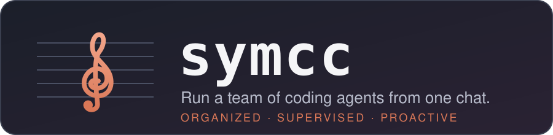

<p align="center">
  
</p>

<p align="center">
  <b>A team lead for your coding agents: it listens, takes notes, organizes the work, and nothing slips.</b>
</p>

<p align="center">
  <b>A team, not a session:</b> other tools run coding agents one chat at a time, with you as the manager. symcc gives them a lead that plans, a board everyone shares, and workers that build in parallel. You stay in charge, and the work keeps moving when you're not pushing it.
</p>

<p align="center">
  <b>A leap toward autonomous coding:</b> you set the direction; the team plans, builds, tests and merges on its own, and only asks you when a decision is really yours.
</p>

<p align="center">
  
  <a href=".claude-plugin/plugin.json"></a>
  <a href="LICENSE"></a>
  <a href="https://github.com/kourgeorge/symcc/commits/main"></a>
</p>

<p align="center">
  <a href="#install">Install</a> · <a href="#quick-start">Quick start</a> · <a href="#how-it-works">How it works</a> · <a href="docs/guide.md">Guide</a> · <a href="docs/reference.md">Reference</a> · <a href="docs/demo.svg">Demo</a>
</p>

<p align="center">
  
</p>

You give a coding agent a task and watch it work. Meanwhile new ideas come up, and you
either interrupt the agent or try to remember them. Big jobs get worse: a dozen things
to fix, no clear view of which change belongs to which item, and the small ones quietly
drop out. The bottleneck isn't how fast the agent writes code. It's keeping track of the work.

symcc turns your Claude Code chat into a lead that takes your ideas at any time, puts
them on a board, and has a team of workers build them. It is vibe coding, with a team
behind it: you keep talking, and the work keeps moving.

## Why symcc

- **A leap toward organized autonomous agents.** Work keeps moving when you step away: scouts (helpers that look for bugs, missing tests and outdated parts on their own timers) send what they find to the lead, who puts it on the board. Workers build, test and merge it, and ask you only when a decision is really yours.
- **See everything.** A live board shows what is running, what is waiting and what needs you.
- **Know why.** Every task and commit records who asked for it and why, so you can go from a line of code back to the request.
- **Order handled for you.** The lead decides which tasks wait for others and which run in parallel. You think about the next question while the team works on the next task.
- **Stay in control.** Review each diff before it merges, edit it, reject it, or switch everything off with `/symcc-off`.

The main parts (all of them are in the [reference](docs/reference.md#all-features)):

- **Lead:** your normal Claude Code chat. It takes ideas any time, splits them into tasks and reports. Change your mind any time: "do T-6 first".
- **Board:** one list for work you asked for and work scouts found: todo / doing / review / done.
- **Workers:** parallel agents, each in its own git worktree and branch, so your branch is untouched until merge.
- **Scouts:** read-only helpers on a timer that look for bugs, missing tests and outdated parts. See [scouts](docs/guide.md#scouts).
- **Tests before merge:** your test commands must pass; if they fail, a new worker gets the output and tries again.
- **Review:** see the diff, then approve, or reject with a reason. See [approval before merge](docs/guide.md#approval-before-merge).

## How symcc is different

**Coding agents** (Claude Code, Codex, OpenCode, Goose) run one agent you talk to. Their helper agents work inside your turn, and you wait for them. Nothing keeps a list of the work after the chat ends.
→ symcc adds a team on top: a lead you talk to, a board that stays between sessions, workers that build in the background, and scouts that look for problems on their own.

**Multi-agent apps** (claudecodeui, T3 Code, cmux and others) let you run several agents side by side, but *you* split the work, keep track of it, check it and merge it.
→ In symcc the lead does that. It turns what you say into tasks, decides their order, starts the workers, runs your tests, merges what passes, and asks you only when the decision is really yours.

**Put together, only in symcc:**
- every task remembers who asked for it and why
- each worker gets its own copy of the code and may change only its own files
- nothing merges unless the tests pass; optionally, a checker tries to break each change first
- questions come back as answers, and never as code changes
- scouts, retries and a health check keep the work going without you pushing it

**Today** symcc runs inside Claude Code. A standalone version that works with other coding agents too is being planned.


## How it works


<p align="center">
  <a href="docs/video/symcc.mp4"></a>
  <br>
  <a href="docs/video/symcc.mp4"><b>▶ Watch the full video</b></a> (78 seconds, no sound)
</p>

You ask (or a scout finds something). The lead makes tasks, sets their order and the files each may change. Workers build in parallel. symcc checks the scope and runs your tests, you review, and it merges. The [steps in full](docs/reference.md#how-it-works-step-by-step) and the [guide](docs/guide.md#a-tasks-life) have the rest.

## Install

You need Claude Code (built and tested with **2.1.319**; the plugin API is early access and can change) and **git**. There is no build step.

```bash
claude plugin install symcc --marketplace kourgeorge/symcc
```

Other ways (try it from a clone, two steps, update, uninstall) and fixes for common problems are in the [reference](docs/reference.md#install-other-ways-and-fixes).

## Quick start

1. **Install** symcc (see above), then start Claude Code in your project. The board panel opens by itself; if not, run `/symcc`.
2. **Keep the board local:** `echo ".symcc/" >> .gitignore`
3. **Set your tests:** tell the lead "set the test command to `npm test`". Without one, changes merge without tests.
4. **Optional, a scout:** a new project starts with example scouts, all paused. Try one with `/symcc-scout <name>`. See [scouts](docs/guide.md#scouts).
5. **Ask for something.** "Add a dark mode toggle." Then watch the board.

## Things you can say

You never have to type a command. Just talk to the lead:

- "what's going on?"
- "do T-4 first" · "T-6 should wait for T-5"
- "T-3 should also handle emails"
- "pause T-5" · "drop T-2" · "stop everything"
- "set the test command to `npm test`" · "give workers 90 minutes"
- "approve T-5" · "reject T-5: the button should be blue"
- "stash this idea" · "show the backlog" · "move T-5 to todo"
- "use the security role for T-12"

## More

- [Guide](docs/guide.md): a task's life, review, the panel, scouts, branches, where files live, safety
- [Reference](docs/reference.md): all features, modes, commands, settings, statuses
- [Architecture picture](docs/architecture.md) and [demo](docs/demo.md): how the pictures are made
- [For developers](docs/guide.md#for-developers-where-the-code-is) and [renaming the plugin](docs/guide.md#renaming-the-plugin)
