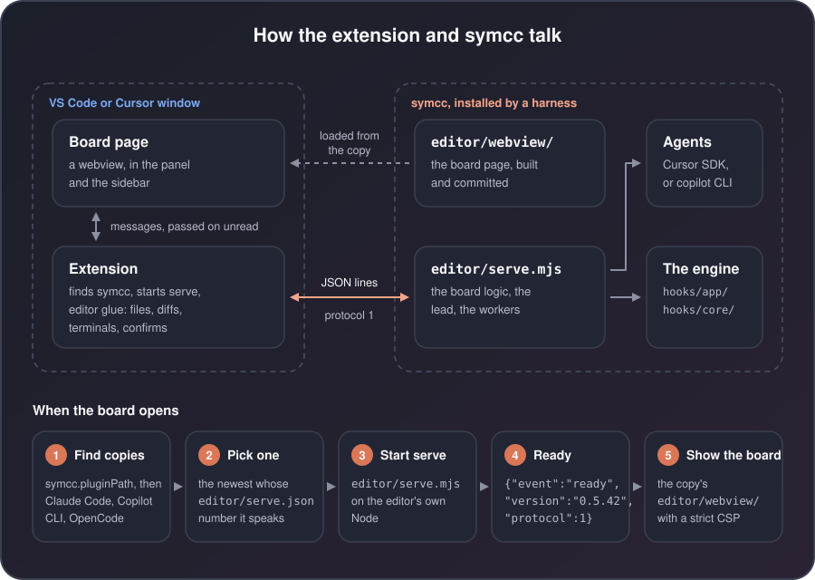

# Architecture

For people who change symcc itself: where the code is, the line between the engine and the clients, how to test it, how to rename the plugin, and how the team picture is made. If you only want to use symcc, see [Get started](get-started.md).

## For developers: where the code is

| File or folder | What's in it |
|---|---|
| [`hooks/register.tsx`](../hooks/register.tsx) | Only the wiring: the `on(...)` calls that hand Claude Code events to the modules below |
| [`hooks/core/`](../hooks/core/) | The board as plain data (`board-file.ts`, `task.ts`, `review.ts`, `banner.ts`, `scouts.ts`, ...). No Claude Code calls, so it's easy to test |
| [`hooks/board.ts`](../hooks/board.ts) | A barrel: it only re-exports `hooks/core/*`, so tests and other files import from one place |
| [`hooks/app/`](../hooks/app/) | What symcc does, with no Claude Code in it (it talks to the host through `Host` in [`hooks/host.ts`](../hooks/host.ts)): the lead's tools (`tools.ts`), workers (`workers.ts`), git (`git.ts`), review and merge, scouts, roles (the built-in worker prompts they go in are in [`prompts/`](../prompts/)). Shared state is the `S` object in `state.ts`; the entry points are in `symcc.ts` |
| [`hooks/claude/`](../hooks/claude/) | The Claude Code adapter: the `Host` made from Claude Code's `$` (`host.ts`), the tool registrations, the agent types and the panel atoms (`panel.ts`) |
| [`hooks/claude/ui/`](../hooks/claude/ui/) | The panel pages and the part above the prompt (`list.tsx`, `task-page.tsx`, `scouts-page.tsx`, `settings.tsx`, ...) |
| [`hooks/name.ts`](../hooks/name.ts) | Everything made from the plugin's name |
| [`types/index.d.ts`](../types/index.d.ts) | The shapes of a task, a try, a scout |
| [`tests/`](../tests/) | The tests: one file per area (the board logic, the panel, merging, scouts, stats, and so on) |
| [`hosts/node/`](../hosts/node/) | symcc with no Claude Code: a `Host` made of plain Node/Bun calls (`host.ts`), the running of agents as `claude -p` processes (shared code in [`hooks/process/`](../hooks/process/): `agents.ts`, `claude-runner.ts`, `record.ts`, `system.ts`; the Node version of the system calls is `system.ts` here), and a tiny command line (`main.ts`). See "Running symcc without Claude Code" below |
| [`hooks/opencode/`](../hooks/opencode/), [`opencode/`](../opencode/) | symcc in OpenCode 2.x: the plugin's setup and which copy runs the board (`plugin.ts`), its `Host` (`host.ts`), the edit guard (`guard.ts`), workers and scouts as OpenCode sessions (`agents.ts`), the lead (`lead.ts`), symcc's tools and slash commands (`tools.ts`), the view file for the TUI (`view.ts`), what the TUI draws (`board-view.ts`) and how (`tui.ts`), and the plugin entries OpenCode loads (`opencode/server.ts`, `opencode/tui.ts`). See [Using symcc in OpenCode](clients.md#using-symcc-in-opencode) |

**Where to add a new feature:** pure logic goes in `hooks/core/`; what symcc does goes in `hooks/app/`; Claude Code wiring goes in `hooks/claude/`; panel pages go in `hooks/claude/ui/`. `hooks/app/` and `hooks/core/` must not import `claude-code` or `node:` modules, or name Claude Code's tools: `sh tests/host-free.sh` (run by `sh scripts/typecheck.sh`) checks this.

**Two rules the loader needs:**

- A function that takes `$` and is imported from another file must be a `function` declaration, not an arrow `const`.
- Panel atoms (`read` / `update`) must be used in the file that declares them. From other files, use the `readX` / `updateX` helpers in `hooks/app/state.ts` (they reach the atoms in `hooks/claude/panel.ts` through the `Host`).

## Engine and clients

For people who change symcc's code. symcc is split into two sides: the **engine** (the part that does the work) and the **clients** (the parts that plug the engine into one program). **Why split it:** symcc runs in more than one program today (Claude Code, OpenCode, and a Node command line), and the board logic should exist once, not once per program. See [Using symcc in OpenCode](clients.md#using-symcc-in-opencode) and [Running symcc without Claude Code](#running-symcc-without-claude-code). This section says where the line is, the rule that keeps it, and which checks watch it. The plan behind it is section 12 of [the standalone app note](research/standalone-app.md).

### The boundary

| Side | What it is | Where it lives |
|---|---|---|
| Engine | Board logic, prompts, the entry functions, the `Host` interface, the process runner, and the screen helpers that need no host | `hooks/core/`, `hooks/app/`, `hooks/process/`, `hooks/host.ts`, `hooks/board.ts`, `hooks/name.ts`, `prompts/`, `kinds/`, `types/`, `hooks/opencode/board-view.ts`, and `hooks/engine.ts` |
| Client (host adapter) | Code that knows one program: its tools, screens, hooks and plugin files | `hooks/claude/`, `hooks/register.tsx`, `hooks/opencode/` (except `board-view.ts`), `opencode/`, `hosts/node/`, `hosts/cursor/` (built into `editor/`), `hooks/copilot/` |

`hooks/copilot/` is the GitHub Copilot CLI host (started in T-957, not usable yet): an extension that joins the Copilot session with symcc's lead tools and `/symcc` commands, shows the text board with `session.log`, and wakes the lead with `session.send`. Its file, command and timer parts are given in, so it imports no Node and is type-checked with the rest of `hooks/`; its tests are `tests/copilot-host.test.ts`. Agents, the edit guard, the band and the bundled `extension.mjs` come later.

`hooks/opencode/board-view.ts` holds no OpenCode code, so it counts as engine, even though it sits in an OpenCode folder. Moving it is left for later (see "What is done and what is next").

### The rule

- The engine never imports a host. No import of `hooks/claude/`, `hooks/opencode/` (the one exception is `board-view.ts`, which `hooks/engine.ts` may re-export), `hosts/node/`, `hosts/cursor/`, `hooks/register.tsx`, `claude-code`, OpenCode, a Node built-in or Bun. Comments that only name a host are fine. Only imports count.
- Hosts should reach the engine through `hooks/engine.ts` only. Today they still import the engine files directly. Switching them is a later step.

### hooks/engine.ts

`hooks/engine.ts` is a list: it only re-exports names, it holds no code. It lists what the hosts use from the engine. Nothing imports it yet. The list may lag behind the hosts: a host can start using a name before it is added here. It gets brought up to date when the split starts.

### The checks

- `tests/host-free.sh` (run by `sh scripts/typecheck.sh`) fails when the engine imports a host. This is the check that fails.
- `tests/engine-names.mjs` (run by `tests/host-free.sh`) compares the list with the names the hosts import. A difference is reported as a note and never fails the tests.
- `tests/engine.test.ts` checks that each name in `hooks/engine.ts` is the same value as in its source file.

Run the first one alone with `sh tests/host-free.sh`.

For the editor entry:

- `tests/editor-contract.sh` (run by `sh scripts/typecheck.sh`) fails when `hosts/cursor/contract.ts` changed and its
  number wasn't reconsidered (see [The contract and its number](#the-contract-and-its-number)).
- `tests/editor-bundle.sh` builds `editor/` into a scratch folder and checks it: serve imports only Node, starts with
  the ready line, and answers the webview on both kinds of agents.
- `sh scripts/build-editor.sh --check` says whether the committed `editor/` is up to date. `sh scripts/typecheck.sh`
  prints it as a note and never fails on it, so an engine change doesn't force a rebuild in every task.

### The editor extension

The VS Code and Cursor extension (`hosts/cursor/extension/`) is a client of the plugin. It holds no engine and no
board. It finds the symcc a harness installed (`hosts/cursor/extension/src/find.ts`), starts that copy's
`editor/serve.mjs`, and shows that copy's `editor/webview/` in its panel and sidebar. It passes lines between the
webview and serve without reading them. It only does what needs the editor: open a file at a line, diffs, terminals,
open a folder, reveal a file, the clipboard, confirms and notifications, the status bar and the badge, read-only
session documents, the proxy settings, restart, and the log. It is released on its own track
([Releasing](releasing.md)). How to use it: [Using symcc in VS Code and Cursor](clients.md#using-symcc-in-vs-code-and-cursor).



`editor/` is the plugin's built editor entry. It is committed, like the Copilot CLI host's `extension.mjs`:

| File | What it is |
|---|---|
| `editor/serve.mjs` | `hosts/cursor/main.ts` built into one file that imports only Node: the engine, serve's board logic and the agents |
| `editor/serve.json` | the contract's number, `{"protocol":1}` |
| `editor/webview/` | `hosts/cursor/extension/webview/` built: `webview.js`, `webview.css` and the codicons |
| `editor/THIRD-PARTY-NOTICES.md` | the licenses of the packages built in |

`sh scripts/build-editor.sh` rebuilds it. The Cursor SDK isn't in it: its license keeps it out of symcc, so serve
fetches it from npm on first use (`hosts/cursor/sdk-fetch.ts`). For Copilot, serve runs the owner's `copilot` CLI.

In development (F5 in this repository), the extension runs the clone's `hosts/cursor/dist/engine.mjs` and its own
webview build instead.

### The contract and its number

`hosts/cursor/contract.ts` is all the extension and serve agree on: serve's command line and environment, its ready
line, the lines each side writes, the files in `editor/`, and the page the webview fills. What the webview and serve
say to each other is internal (`hosts/cursor/protocol.ts`), and can change in any plugin release.

The contract has a number, `PROTOCOL`. serve's ready line carries it with symcc's version,
`{"event":"ready","version":"0.5.42","protocol":1}`, and `editor/serve.json` repeats it, so the extension can choose a
copy without starting it. The extension says which range it speaks and runs only a copy in that range.

Raise the number when an extension that speaks the current one couldn't follow the change: a field, action or line
renamed or removed, a new line the extension must answer, or a change to the files in `editor/` or to the page. Keep
it when such an extension can still follow: a new editor action that needs no answer (the extension ignores actions it
doesn't know), a new optional field, or a comment.

`hosts/cursor/contract.sha256` records the number and the file's hash it was last looked at with.
`tests/editor-contract.sh` fails when the file changed and the record didn't, so each change makes someone decide.
Either way, write the line it prints into the record. How to release a raised number: [Releasing](releasing.md#the-protocol-number).

### What is done and what is next

Done now (no code moves, nothing the owner sees changes): the `host-free` check also covers `hooks/process/`, `board-view.ts` and `hooks/engine.ts`, and `hooks/engine.ts` exists as a list.

Next, for when the separate app is built:

- Move the screen helpers out of `hooks/opencode/` (S1 in the note).
- Point the three hosts at `hooks/engine.ts` (S4).
- Add a check that hosts import the engine only through `hooks/engine.ts` (S5).

### The export list

This is the list in `hooks/engine.ts`, by the file each name comes from (paths are relative to the project folder; `hooks/app/ask` means `hooks/app/ask.ts`). A name marked `type` is a type only.

**`hooks/app/ask`**: `ASK_TOOL_DEF`, `hookFailed`, `listedKind`

**`hooks/app/board-mode`**: `setBoardMode`, `stopForQuit`

**`hooks/app/git`**: `setupGit`

**`hooks/app/kinds`**: `changeKind`, `kindDraftOf`, `kindLists`, `kindView`, `loadKinds`, `newKindFile`, `saveKindDraft`

**`hooks/app/logo`**: `logoNow`, `noteLogoWidth`

**`hooks/app/open`**: `openPane`, `paneArgs`, `type PaneTab`, `resetPane`

**`hooks/app/org-mem`**: `deleteOrgMem`, `orgMemNow`, `orgMemView`, `resetOrgMemView`

**`hooks/app/plan`**: `seePlan`

**`hooks/app/questions`**: `answerOnBoard`, `boardAnswered`, `popupCall`

**`hooks/app/review`**: `changedFiles`, `folderDiff`

**`hooks/app/roles`**: `changeRole`, `loadRoles`, `newRoleFile`, `roleDraftOf`, `roleLists`, `roleView`, `saveRoleDraft`

**`hooks/app/scouts`**: `cancelScoutEdit`, `editScout`, `loadScoutResults`, `loadScoutRunHistory`, `newScout`, `readScoutRunReport`, `runScoutNow`, `saveScout`, `scoutPlace`, `scoutPlaceValue`, `setScoutPaused`

**`hooks/app/starts`**: `drainStarts`, `leadTurn`, `StartCancelled`

**`hooks/app/state`**: `approving`, `changesCache`, `checkerRuns`, `finishing`, `openDays`, `type PaneView`, `queuedWorkers`, `S`, `scoutRuns`, `starting`, `toolName`, `useName`, `workers`

**`hooks/app/store`**: `findRoot`, `isAbsolute`, `isWorkerFolder`, `load`, `mainRoot`, `normalPath`, `path`, `safeWrite`

**`hooks/app/symcc`**: `agentFinished`, `type AgentRunEnd`, `BOARD_OPENED`, `type CommandAnswer`, `COMMANDS`, `guardStart`, `leadGuideText`, `leadUpdate`, `otherToolDone`, `ownerTyped`, `runCommand`, `sessionCleared`, `sessionEnd`, `sessionStart`, `sessionStarting`, `toolCall`, `toolCallFailed`, `toolCheck`, `toolCheckFailed`

**`hooks/app/tell`**: `brief`, `noteForLead`, `tellLead`

**`hooks/app/tools`**: `allowAskedFiles`, `ownerSettings`, `refuseAskedFiles`, `runTool`, `TOOLS`

**`hooks/app/workers`**: `agentOnBoard`, `mergeOutcome`, `mergingNow`, `pump`, `type TurnEnd`

**`hooks/board`**: `actionButtonLabel`, `ALL_CLEAR`, `ALWAYS_ON_KINDS`, `answerChoices`, `answeredLeadLine`, `answerText`, `archivedNote`, `archivedOf`, `BACKLOG_SHOWN`, `backlogMoreLabel`, `BAD_EVERY_STATE`, `bandBrand`, `bandLeads`, `bandNote`, `bandWhere`, `bannerCounts`, `bannerLines`, `bannerRule`, `type BannerTone`, `type BoardTask`, `boxHint`, `canMarkMerged`, `canPickRole`, `cantPlayNotify`, `checkerOn`, `copyToast`, `crossBranchNotes`, `cutDiff`, `DEFAULT_ROLE`, `type DetailRow`, `detailRows`, `DIFF_COLOR`, `DIFF_LINES`, `type DiffFile`, `diffKeys`, `diffKinds`, `emptyBoard`, `everyMinutesOf`, `everyText`, `failAsks`, `failNext`, `fileWaitText`, `findKind`, `findRole`, `fitRow`, `fmtDuration`, `fmtRun`, `fmtTotal`, `foldedRow`, `folderName`, `footerRule`, `groupLabel`, `groupSummaryParts`, `hintLines`, `intoOf`, `isAnswered`, `isCheckerRole`, `isInvestigation`, `isNothing`, `isScoutRunReport`, `isSettingPage`, `type KeyHint`, `type KindDef`, `kindMark`, `kindNameError`, `kindsKeys`, `kindTag`, `listKeys`, `localOffset`, `mergeKinds`, `mergeRoles`, `MODE_MEANING`, `MODE_NAME`, `modeButton`, `modeLabel`, `modeOf`, `needsYou`, `newestFirst`, `nextMode`, `offStatusParts`, `originOf`, `originSegs`, `type OwnerQuestion`, `ownersTurn`, `packRows`, `panelSections`, `parseScoutRuns`, `parseSettingValue`, `pickHint`, `planBandText`, `promptsOfRole`, `questionsForYou`, `questionsLabel`, `ROLE_PLACEHOLDERS`, `ROLE_PROMPTS`, `ROLE_SLOT`, `roleChoices`, `type RoleDef`, `roleEditKeys`, `roleKeys`, `roleMark`, `roleNameError`, `roleOf`, `rolePromptKeys`, `type RolePromptKind`, `rolesKeys`, `roleTag`, `rowCell`, `rowEndText`, `rowExtra`, `rowMark`, `rowStates`, `safeScoutFile`, `type ScoutEditField`, `scoutEditKeys`, `scoutFile`, `scoutHowTo`, `scoutIcon`, `scoutKeys`, `scoutLastRunProblem`, `scoutLastText`, `scoutListKeys`, `scoutListRows`, `scoutOutcomeTone`, `scoutRow`, `scoutRunLine`, `scoutRunsFile`, `scoutRunTasks`, `scoutTone`, `SEARCH_WORDS`, `searchBoxHint`, `searchLine`, `searchTasks`, `SECTION_LABEL`, `type Seg`, `SETTING_GROUPS`, `settingChoices`, `settingInfo`, `settingShown`, `type SettingName`, `type SettingPage`, `SETTINGS`, `type SettingsInput`, `settingsKeys`, `settingValue`, `shownStatus`, `showsAnswer`, `sortScouts`, `type StageMark`, `stageSegs`, `STATE_LABEL`, `stateText`, `STATUS_BADGE`, `STATUS_MARK`, `STATUS_WORD`, `statusBadge`, `statusCell`, `statusCounts`, `statusMark`, `sumRuns`, `type TaskAction`, `type TaskActionId`, `taskActions`, `taskAsks`, `taskCopyText`, `taskKeys`, `taskPhase`, `taskReports`, `taskStage`, `testsShort`, `TITLE_ROOM`, `versionMark`, `whyFailed`, `withCrew`, `wrapSegs`, `YOUR_EDITS`

**`hooks/core/ask`**: `ASK_TOOL`

**`hooks/core/banner`**: `shortHome`

**`hooks/core/board-file`**: `normId`

**`hooks/core/days`**: `when`

**`hooks/core/def-files`**: `type BrokenDef`, `brokenLabel`, `brokenNamed`, `defNamed`, `defSource`, `type DefSource`, `sourceLabel`

**`hooks/core/history`**: `HISTORY_COLOR`, `historyEvent`, `historyTime`

**`hooks/core/org-mem`**: `ORG_MEM_EMPTY`, `ORG_MEM_TITLE`, `orgMemAbout`, `orgMemCount`, `orgMemDeleteAsk`, `orgMemFile`, `orgMemKeys`, `type OrgMemNote`, `orgMemNoteHead`, `orgMemNoteKey`

**`hooks/core/path-guard`**: `spawnFailedText`

**`hooks/core/prompts`**: `basePromptFor`, `SCOUT_BASE`, `WORKER_BASE`

**`hooks/core/questions`**: `normQid`

**`hooks/core/roles`**: `ROLE_TOOL_WORDS`

**`hooks/core/runs`**: `cleanTokens`, `fmtTokens`, `sumTokens`, `TOKEN_KINDS`, `tokenCount`

**`hooks/core/scouts`**: `SCOUT_BOARD_TOOLS`

**`hooks/core/stats`**: `type LeadCall`, `rangeSpan`, `type StatsRange`

**`hooks/core/task-sections`**: `type SectionLine`, `type TaskSection`, `taskSections`

**`hooks/core/text`**: `jsonObj`, `squash`

**`hooks/host`**: `ALL_FEATURES`, `type FileTouch`, `type Host`, `type HostAgent`, `type HostAgentKind`, `type HostAgentStart`, `type HostFeatures`, `type HostFileEntry`, `type HostFileStat`, `type HostLead`, `type HostRunResult`, `type HostWords`, `type LeadSend`, `type LeadUsage`, `manifestVersion`, `noUi`, `type PanelValues`, `SYMCC_WORDS`

**`hooks/name`**: `cleanName`, `dataDir`, `DEFAULT_NAME`, `ICON`, `namesFor`

**`hooks/opencode/board-view`**: `actionCommand`, `answerOptions`, `approveInProgress`, `approveSent`, `type ApproveSent`, `bandDraw`, `type BandHit`, `CHOICE_KEYS`, `type ChoiceKey`, `groupId`, `groupOf`, `GROUPS_OPEN`, `hasPage`, `LETTER_KEYS`, `type LetterKey`, `type Line`, `moveCursor`, `orgMemNoteOf`, `OWN_ANSWER`, `PANEL_TABS`, `type PanelAction`, `type PanelGroup`, `type PanelHit`, `type PanelKey`, `panelKeys`, `panelLines`, `panelRoleChoices`, `type PanelTab`, `panelTaskActions`, `parseViewFile`, `type ScoutRuns`, `scoutRunsIn`, `settingGroupId`, `settingGroupOf`, `SETTINGS_OPEN`, `settingsPlace`, `TASK_ACTION_COMMANDS`, `VIEW_FILE`, `VIEW_RUNS_KEPT`, `type ViewChanges`, `type ViewDef`, `viewDefs`, `type ViewFile`, `viewFileText`

**`hooks/process/agents`**: `type AgentRunner`, `processAgents`, `type ProcessAgents`

**`hooks/process/claude-runner`**: `claudeRunner`

**`hooks/process/record`**: `PROCESSES_FILE`

**`hooks/process/system`**: `type ProcessSystem`

**`types`**: `type SymccMode`, `type SymccScout`, `type SymccStatus`, `type SymccTask`, `type SymccTokens`, `type SymccView`

## Working on symcc

- **Run the tests:** `claude plugin test .` from the project folder.
- **Where tests live:** in `tests/`, one file per area (for example `board.test.ts` for the board logic and `pane.test.tsx` for the panel).
- **Layout:** `hooks/core/` holds the logic you can test (plain data, no Claude Code calls). `hooks/app/` holds what symcc does, also with no Claude Code. `hooks/claude/` and `hooks/claude/ui/` do the wiring to Claude Code, and `hooks/register.tsx` only connects events. Put new logic in `hooks/core/` when you can. See the code map above.
- **Test the Node host:** `sh scripts/test-node-host.sh` (bun test, not `claude plugin test`: it needs files and processes).
- **Test the OpenCode plugin:** `sh scripts/test-opencode-host.sh` (bun test with a fake OpenCode context; OpenCode itself is not needed).
- **Rebuild the SVG pictures:** the pictures are made by scripts, so don't edit them by hand. The steps are in [How to change the picture](#how-to-change-the-picture) below (for `architecture.svg`), in [`demo.md`](demo.md) (for `demo.svg`) and in [`editor-pictures.md`](editor-pictures.md) (for the `editor-*.svg` pictures of the VS Code and Cursor extension).

### Running symcc without Claude Code

`hosts/node/` runs the same engine (`hooks/app/` and `hooks/core/`) from a plain command line, with each worker as its own `claude -p` process. It has no board panel, no band and no plan mode. It is a small test of the idea, not a full client. Each command is one session:

```
bun hosts/node/main.ts --root <project> tool settings '{"test_commands":["npm test"]}'
bun hosts/node/main.ts --root <project> add "Say hello" "Create hello.txt" --files hello.txt
bun hosts/node/main.ts --root <project> [--model haiku] tick     # starts ready tasks, waits for their tests and merges
bun hosts/node/main.ts --root <project> board
bun hosts/node/main.ts --root <project> cmd symcc-mode review    # any slash command
```

What the lead would be told is printed after each answer, under `[lead]`. A worker's file list is handed to `claude -p` as its own permission rules (`--permission-mode dontAsk`, with `Edit(...)` and `Write(...)` rules for the task's files, and git writes denied). There is no symcc hook guard there, so those rules are the only check on git. They come from the same deny list as the hook guard (`hooks/core/git-guard.ts`): a worker may commit, merge, cherry-pick, revert, restore, reset, add, rm, bisect and rebase its own branch, while push, fetch, pull, remote, tag, config, stash, worktree, update-ref, symbolic-ref, branch, switch, `rebase -x`/`--exec`/`--update-refs`, `bisect run` and `--autostash` are refused; a checker or scout may not change git at all. Claude Code's rules match the start of a command, not the folder it acts on, so every git call that starts with an option (`git -C <dir> ...`, `git --git-dir=...`, `git -c ...`) is refused, as are `env git`, `xargs git` and the like, `git checkout` as a whole (use `git restore <file>`) and a rebase with more than one word. Reading with git (`status`, `diff`, `log`, `show`, `blame`, `grep`) still works. A command that hides git inside another program (`sh -c "git push"`, a script) is not caught by these rules. The scope check at merge time still stands behind it. A `claude -p` worker has no `ask_owner` tool, and it can't be sent messages while it runs: to stop it, its process is ended. Every running worker, scout or checker process is written to `.symcc/processes.json` (its pid, task, folder and start time) and removed when it ends; on a fresh start symcc stops the ones an earlier run left alive and clears the rest.

## Renaming the plugin

The name comes from one place: `"name"` in `.claude-plugin/plugin.json`. Everything else is
made from it: the data folder (`.<name>/`), task branches (`<name>/T-1`), the commit author,
the agent types (`<name>:worker`, `<name>:scout`), the tool names (`mcp__<name>__add`), the
slash commands (`/<name>`, `/<name>-mode`, `/<name>-help`, ...) and all the text on the board.
To rename it:

1. Change `"name"` in `.claude-plugin/plugin.json`, and `DEFAULT_NAME` in `hooks/name.ts`.
2. Change the name in the `atom({ plugin: ... })` lines near the top of
   `hooks/claude/panel.ts` (`opened`, `tab`, `scout`, `view`) and under `PluginState` in `types/claude.d.ts`. Claude Code reads
   which values a plugin keeps before it runs, so these must be written out as text.
3. Move the old data folder in each project, e.g. `mv .symcc .crew`. Nothing is moved for
   you, and nothing tells you: until you move it, the plugin starts a new, empty board.
4. Update `.gitignore` to ignore the new folder (`.crew/`).

Old task branches keep their old names (`symcc/T-1`); they still work.

### Adding a blog post to the site

Put one Markdown file in `docs/blog/`, named `YYYY-MM-DD-<slug>.md` (the date comes from the file
name). Start it with a `# Title` line; the paragraph right after it is the summary shown in the
blog list and the RSS feed. The site build (`scripts/build-site.ts`) makes `blog/<slug>.html`,
the list `blog/index.html` (newest first) and `blog/rss.xml`, and adds a Blog link to the header.
With no files in `docs/blog/`, there is no Blog link and no blog pages.

## The team picture

This part is for people who want to change the team animation.

`docs/architecture.svg` is the moving picture in [How it works](how-it-works.md#pictures-and-the-video).
It shows who does what in symcc: you (the owner), the lead, the board, the workers and the scouts.
It is one SVG file with SMIL animation only: no JavaScript, no outside fonts or images, so
GitHub plays it inside an `` tag. It is 900x560, loops every 41 seconds, and uses the
same colors and rounded dark card as `docs/logo.svg`, so it looks the same in light and dark mode.

### Who is in the picture

| Role | Where | How it looks |
|---|---|---|
| You, the owner | top left | a person figure |
| The lead (your Claude Code chat) — plans and supervises | below you | an orange robot |
| The board | middle | a card with task rows T-1 … T-4 and their status: todo, doing, review, done |
| Worker agents | bottom | three blue robots, each in its own dashed box: "worker 1 · worktree T-1" and so on, so they work apart and don't collide |
| Scouts | right side | green robots with a clock: "scout: tests · every 30 min" (wakes up) and "scout: docs · every day" (keeps sleeping) |
| main branch | very bottom | a line that grows one dot each time a task is merged |

### What happens when

| Time (s) | Caption | What happens |
|---|---|---|
| 0–4.5 | 1/6 You say what you want | Your speech bubble: "add search, nicer errors, and dark mode" |
| 4.5–9 | 2/6 The lead breaks it into tasks | The lead says "3 tasks: T-1, T-2, T-3"; three cards fly from the lead onto the board as `todo` |
| 9–14 | 3/6 Workers pick up tasks in parallel | Each card flies to its own worker's box ("worktree T-1/2/3"); the workers bob and type; the board says `doing` |
| 14–18 | 4/6 Every change is checked | In each box: "own files only ✓", "tests pass ✓"; the board says `review` |
| 18–24 | 5/6 You supervise and approve | The lead tells you "T-1 ready for review"; you press "approve T-1"; the card goes into main (new dot), T-1 is `done`. Then "T-2, T-3 ready too", approved, two more dots |
| 24–35.8 | 6/6 Scouts look ahead on their own | The tests scout wakes up (its clock rings), looks at `search.ts` through its telescope, and sends the lead a note: "src/search.ts:42 has no tests". The lead adds T-4 to the board; free worker 1 picks it up in "worktree T-4"; checks pass; review; you approve; it is merged (dot T-4) |
| 35.8–41 | (end card) | "You direct. The lead plans. Workers build. Scouts find what's next. Everything on one board." |

### How to change the picture

Don't edit the SVG by hand; change the script below and run it again. Every piece is shown
in time windows `[start, end]` in seconds (`show(...)`) and moved with `move(...)`. The
story times are in `tasks`, `workers` and `captions`; `T` is the loop length.

From the project folder:

```bash
mkdir -p /tmp/symcc-arch
sed -n '/^```js$/,/^```$/p' docs/architecture.md | sed '1d;$d' > /tmp/symcc-arch/gen.js
node /tmp/symcc-arch/gen.js > docs/architecture.svg
xmllint --noout docs/architecture.svg
```

Then open `docs/architecture.svg` in a browser to watch it.

### The picture's script

```js
// docs/architecture.svg generator. Every piece is shown in time windows [start, end]
// (seconds) inside one loop of T seconds. Run: node gen.js > docs/architecture.svg
const T = 41
const W = 900, H = 560
const SANS = "-apple-system, 'Segoe UI', Helvetica, Arial, sans-serif"
const MONO = "ui-monospace, 'SF Mono', Menlo, Consolas, 'DejaVu Sans Mono', monospace"
const C = {
  bg1: '#1b1f2a', bg2: '#2a2233', edge: '#3a3f4f', line: '#4a5063', panel: '#222634',
  text: '#f5f5f7', dim: '#b8bccb', peach: '#f2a58a', orange: '#d97757',
  grey: '#8b90a3', blue: '#7aa7f0', yellow: '#e8c66a', green: '#7fd18b',
  worker: '#9fb6e0', scout: '#8fd1b0', eye: '#1b1f2a',
}
const STATUS = { todo: C.grey, doing: C.blue, review: C.yellow, done: C.green }

// ---------- animation helpers ----------
function anim(tag, attr, frames, extra = '') {
  let fr = frames.map(([t, v]) => [Math.max(0, Math.min(T, t)), v])
  if (fr[0][0] > 0) fr.unshift([0, fr[0][1]])
  if (fr[fr.length - 1][0] < T) fr.push([T, fr[fr.length - 1][1]])
  for (let i = 1; i < fr.length; i++) if (fr[i][0] <= fr[i - 1][0]) fr[i][0] = fr[i - 1][0] + 0.002
  fr = fr.filter(([t], i) => i === 0 || t < T || i === fr.length - 1)
  fr[fr.length - 1][0] = T
  const kt = fr.map(([t]) => +(t / T).toFixed(6)).join(';')
  const vs = fr.map(([, v]) => v).join(';')
  return `<${tag} attributeName="${attr}" dur="${T}s" repeatCount="indefinite" ${extra}values="${vs}" keyTimes="${kt}"/>`
}
// opacity frames for windows [[a,b],...]
function showFrames(win, f = 0.25) {
  const fr = []
  for (const [a, b] of win) {
    if (a <= 0) fr.push([0, 1]); else fr.push([a, 0], [a + f, 1])
    if (b < T) fr.push([b, 1], [Math.min(T, b + f), 0])
  }
  return fr
}
const show = (win, body, f) => {
  const fr = showFrames(win, f)
  return `<g opacity="${fr[0][0] <= 0 ? fr[0][1] : 0}">${anim('animate', 'opacity', fr)}${body}</g>`
}
const move = (frames, body) =>
  `<g>${anim('animateTransform', 'transform', frames.map(([t, x, y]) => [t, `${x} ${y}`]), 'type="translate" ')}${body}</g>`
// fast back-and-forth during windows (for "working" wiggles)
function wiggle(win, a, b, step = 0.25) {
  const fr = [[0, a]]
  for (const [s, e] of win) {
    fr.push([s, a])
    let k = 0
    for (let t = s + step; t < e; t += step) fr.push([t, k++ % 2 ? a : b])
    fr.push([e, a])
  }
  return fr
}
const text = (x, y, s, o = {}) =>
  `<text x="${x}" y="${y}" font-size="${o.size || 14}" fill="${o.fill || C.text}"${o.bold ? ' font-weight="700"' : ''}${o.anchor ? ` text-anchor="${o.anchor}"` : ''} font-family="${o.mono ? MONO : SANS}">${s}</text>`

// ---------- figures ----------
function person(cx, cy) {
  return `<circle cx="${cx}" cy="${cy - 14}" r="13" fill="${C.peach}"/>` +
    `<path d="M${cx - 22} ${cy + 28} Q${cx - 22} ${cy + 4} ${cx} ${cy + 4} Q${cx + 22} ${cy + 4} ${cx + 22} ${cy + 28} Z" fill="${C.peach}"/>`
}
// robot; eyes: 'open' or windows when awake (closed otherwise)
function robot(cx, cy, color, awake = null) {
  const eyesOpen = `<circle cx="${cx - 7}" cy="${cy - 10}" r="3.5" fill="${C.eye}"/><circle cx="${cx + 7}" cy="${cy - 10}" r="3.5" fill="${C.eye}"/>`
  const eyesShut = `<g stroke="${C.eye}" stroke-width="2.5" stroke-linecap="round"><line x1="${cx - 10}" y1="${cy - 9}" x2="${cx - 4}" y2="${cy - 9}"/><line x1="${cx + 4}" y1="${cy - 9}" x2="${cx + 10}" y2="${cy - 9}"/></g>`
  let eyes = eyesOpen
  if (awake) {
    const asleep = []; let p = 0
    for (const [a, b] of awake) { if (a > p) asleep.push([p, a]); p = b }
    if (p < T) asleep.push([p, T])
    eyes = show(awake, eyesOpen, 0.1) + show(asleep, eyesShut, 0.1)
  }
  return `<line x1="${cx}" y1="${cy - 22}" x2="${cx}" y2="${cy - 31}" stroke="${color}" stroke-width="2.5"/>` +
    `<circle cx="${cx}" cy="${cy - 32}" r="3.5" fill="${color}"/>` +
    `<rect x="${cx - 18}" y="${cy - 22}" width="36" height="26" rx="8" fill="${color}"/>` + eyes +
    `<rect x="${cx - 14}" y="${cy + 7}" width="28" height="22" rx="6" fill="${color}" opacity="0.8"/>`
}
function clock(cx, cy, color) {
  return `<circle cx="${cx}" cy="${cy}" r="10" fill="none" stroke="${color}" stroke-width="2.2"/>` +
    `<path d="M${cx} ${cy - 6} V${cy} H${cx + 5}" fill="none" stroke="${color}" stroke-width="2" stroke-linecap="round"/>`
}
const check = (x, y, label) => text(x, y, `${label} <tspan fill="${C.green}" font-weight="700">✓</tspan>`, { fill: C.green, size: 14 })

// ---------- story data ----------
const LEAD = [56, 206]
const rowY = i => 112 + i * 46
const BX = [40, 320, 600]
const DX = [200, 320, 440, 560]
const tasks = [
  { id: 'T-1', title: 'search', w: 0, fly: [5, 9.5, 21.2], land: [5.8, 10.3, 22],
    st: { todo: 5.8, doing: 10.3, review: 15.6, done: 22 } },
  { id: 'T-2', title: 'nicer errors', w: 1, fly: [5.8, 10, 22.4], land: [6.6, 10.8, 23.2],
    st: { todo: 6.6, doing: 10.8, review: 16.4, done: 23.2 } },
  { id: 'T-3', title: 'dark mode', w: 2, fly: [6.6, 10.5, 23.1], land: [7.4, 11.3, 23.9],
    st: { todo: 7.4, doing: 11.3, review: 17.1, done: 23.9 } },
  { id: 'T-4', title: 'tests for search', w: 0, fly: [29, 30.2, 33.5], land: [29.8, 31, 34.3],
    st: { todo: 29.8, doing: 31, review: 32.5, done: 34.3 } },
]
// what each worker box shows: [start, end, task index or null], plus work and check windows
const workers = [
  { slots: [[10.3, 21.2, 0], [31, 33.5, 3]], work: [[10.3, 14.5], [31, 31.9]],
    own: [[14.5, 21.2], [31.9, 33.5]], tests: [[15.2, 21.2], [32.4, 33.5]] },
  { slots: [[10.8, 22.4, 1]], work: [[10.8, 15.3]], own: [[15.3, 22.4]], tests: [[16, 22.4]] },
  { slots: [[11.3, 23.1, 2]], work: [[11.3, 16]], own: [[16, 23.1]], tests: [[16.7, 23.1]] },
]
const captions = [
  [0, 4.5, 'You say what you want'],
  [4.5, 9, 'The lead breaks it into tasks'],
  [9, 14, 'Workers pick up tasks in parallel'],
  [14, 18, 'Every change is checked'],
  [18, 24, 'You supervise and approve'],
  [24, 35.8, 'Scouts look ahead on their own'],
]
const END = 35.8
const SCOUT_WAKE = 24.5

// ---------- build ----------
const out = []
out.push(`<svg xmlns="http://www.w3.org/2000/svg" width="${W}" height="${H}" viewBox="0 0 ${W} ${H}" role="img" aria-label="How symcc works: you are the owner. You tell the lead agent what you want; it breaks the work into tasks on the board; worker agents build them in parallel, each in its own worktree; every change is checked and tested; you approve and it is merged into main. Scouts wake up on a timer, find the next job and report it to the lead, which adds a task for a free worker.">`)
out.push(`<title>How symcc works</title>`)
out.push(`<defs><linearGradient id="bg" x1="0" y1="0" x2="1" y2="1"><stop offset="0" stop-color="${C.bg1}"/><stop offset="1" stop-color="${C.bg2}"/></linearGradient></defs>`)
out.push(`<rect x="1" y="1" width="${W - 2}" height="${H - 2}" rx="24" fill="url(#bg)" stroke="${C.edge}" stroke-width="2"/>`)

// captions
captions.forEach(([a, b, s], i) => out.push(show([[a, b]],
  `<text x="${W / 2}" y="46" text-anchor="middle" font-size="21" font-family="${SANS}"><tspan fill="${C.orange}" font-weight="700">${i + 1}/6  </tspan><tspan fill="${C.text}" font-weight="700">${s}</tspan></text>`)))

// you and the lead
out.push(person(90, 92))
out.push(text(125, 100, `<tspan font-weight="700" fill="${C.peach}">You</tspan> — the owner`, { size: 16 }))
out.push(robot(90, 232, C.orange))
out.push(text(125, 228, 'The lead', { size: 16, bold: true, fill: C.orange }))
out.push(text(125, 248, 'plans and supervises', { fill: C.dim }))

// board
out.push(`<rect x="330" y="70" width="290" height="240" rx="14" fill="${C.panel}" stroke="${C.line}" stroke-width="1.5"/>`)
out.push(text(346, 96, 'Board', { size: 16, bold: true }))
out.push(text(604, 96, 'one place for every task', { size: 13, fill: C.dim, anchor: 'end' }))
tasks.forEach((t, i) => {
  const y = rowY(i)
  let body = `<rect x="344" y="${y}" width="262" height="36" rx="8" fill="${C.bg1}" stroke="${C.edge}"/>` +
    text(356, y + 23, t.id, { mono: true, bold: true, size: 14 }) + text(398, y + 23, t.title, { size: 14 })
  const order = ['todo', 'doing', 'review', 'done']
  order.forEach((s, k) => {
    const end = k < 3 ? t.st[order[k + 1]] : T
    body += show([[t.st[s], end]],
      `<rect x="528" y="${y + 8}" width="68" height="21" rx="10.5" fill="${STATUS[s]}" opacity="0.22"/>` +
      `<rect x="528" y="${y + 8}" width="68" height="21" rx="10.5" fill="none" stroke="${STATUS[s]}"/>` +
      text(562, y + 23, s, { size: 13, fill: STATUS[s], anchor: 'middle', bold: true }), 0.15)
  })
  out.push(show([[t.st.todo, T]], body))
})

// scouts
out.push(`<rect x="636" y="70" width="240" height="240" rx="14" fill="${C.panel}" stroke="${C.line}" stroke-width="1.5"/>`)
out.push(text(652, 96, 'Scouts', { size: 16, bold: true }))
out.push(text(860, 96, 'look ahead', { size: 13, fill: C.dim, anchor: 'end' }))
// scout 1 (wakes up)
out.push(robot(680, 148, C.scout, [[SCOUT_WAKE, T]]))
const clockShake = []
for (let t = SCOUT_WAKE, k = 0; t < SCOUT_WAKE + 1.2; t += 0.1, k++) clockShake.push([t, `${k % 2 ? -18 : 18} 718 120`])
clockShake.unshift([SCOUT_WAKE - 0.01, '0 718 120']); clockShake.push([SCOUT_WAKE + 1.25, '0 718 120'])
out.push(`<g>${anim('animateTransform', 'transform', clockShake, 'type="rotate" ')}${clock(718, 120, C.scout)}</g>`)
out.push(show([[0, SCOUT_WAKE]], `<g>${anim('animate', 'opacity', wiggle([[0, SCOUT_WAKE]], 1, 0.35, 0.8))}${text(702, 152, 'z z', { size: 14, fill: C.dim, bold: true })}</g>`))
// telescope + the file it looks at
out.push(show([[SCOUT_WAKE + 0.5, T]],
  `<g transform="rotate(-12 700 140)"><rect x="700" y="134" width="34" height="11" rx="3" fill="${C.orange}"/><rect x="730" y="131" width="10" height="17" rx="3" fill="${C.peach}"/></g>`))
const scan = [[0, 0]]
for (let t = 25.5, k = 0; t <= 27.5; t += 0.5, k++) scan.push([t, k % 2 ? 0 : 30])
out.push(show([[25.2, 28.6]],
  `<rect x="770" y="110" width="88" height="64" rx="6" fill="${C.bg1}" stroke="${C.edge}"/>` +
  text(778, 126, 'search.ts', { size: 13, mono: true, fill: C.dim }) +
  `<g fill="${C.line}"><rect x="778" y="136" width="60" height="5" rx="2"/><rect x="778" y="148" width="44" height="5" rx="2"/><rect x="778" y="160" width="66" height="5" rx="2"/></g>` +
  move(scan.map(([t, y]) => [t, 0, y]), `<rect x="772" y="132" width="84" height="12" rx="3" fill="${C.yellow}" opacity="0.35"/>`)))
out.push(text(652, 200, 'scout: tests · every 30 min', { size: 14, fill: C.scout }))
out.push(show([[0, SCOUT_WAKE]], text(652, 218, 'asleep', { size: 13, fill: C.dim })))
out.push(show([[SCOUT_WAKE, 28.5]], text(652, 218, 'awake: reading the code…', { size: 13, fill: C.yellow })))
out.push(show([[28.5, T]], text(652, 218, 'reported 1 thing to the lead', { size: 13, fill: C.green })))
// scout 2 (stays asleep)
out.push(robot(680, 270, C.scout, [[T + 1, T + 2]]))
out.push(clock(718, 242, C.scout))
out.push(`<g>${anim('animate', 'opacity', wiggle([[0, T]], 1, 0.35, 0.8))}${text(702, 274, 'z z', { size: 14, fill: C.dim, bold: true })}</g>`)
out.push(text(738, 266, 'scout: docs', { size: 14, fill: C.scout }))
out.push(text(738, 284, 'every day', { size: 13, fill: C.dim }))

// workers
workers.forEach((wk, w) => {
  const bx = BX[w]
  out.push(`<rect x="${bx}" y="322" width="260" height="140" rx="14" fill="${C.panel}" stroke="${C.line}" stroke-width="1.5" stroke-dasharray="6 4"/>`)
  // header: free or own worktree
  const free = []; let p = 0
  for (const [a, b] of wk.slots) { free.push([p, a]); p = b }
  free.push([p, T])
  out.push(show(free, text(bx + 14, 344, `worker ${w + 1} · <tspan fill="${C.dim}">free</tspan>`, { size: 14, bold: true })))
  for (const [a, b, ti] of wk.slots) {
    const t = tasks[ti]
    out.push(show([[a, b]], text(bx + 14, 344, `worker ${w + 1} · <tspan fill="${C.peach}">worktree ${t.id}</tspan>`, { size: 14, bold: true })))
    out.push(show([[a, b]],
      `<rect x="${bx + 100}" y="354" width="148" height="26" rx="6" fill="${C.bg1}" stroke="${C.peach}"/>` +
      text(bx + 110, 372, `<tspan font-weight="700">${t.id}</tspan> · ${t.title}`, { size: 13 })))
  }
  // the robot bobs while it works
  out.push(move(wiggle(wk.work, 0, -4).map(([t, v]) => [t, 0, v]), robot(bx + 50, 412, C.worker)))
  // typing lines while working
  const lines = [0, 1, 2].map(k =>
    `<rect x="${bx + 100}" y="${392 + k * 13}" height="6" rx="3" fill="${C.worker}" width="40">` +
    anim('animate', 'width', wiggle(wk.work, 40 + k * 20, 120 - k * 25, 0.3 + k * 0.07)).replace('<animate', '<animate') + `</rect>`).join('')
  out.push(show(wk.work, lines))
  out.push(show(wk.own, check(bx + 100, 408, 'own files only')))
  out.push(show(wk.tests, check(bx + 100, 432, 'tests pass')))
})

// main branch
const mergeAt = tasks.map(t => t.st.done)
out.push(text(40, 505, 'main', { size: 16, mono: true, bold: true, fill: C.peach }))
const grow = [[0, 100]]
mergeAt.forEach((m, i) => grow.push([m - 0.4, i ? DX[i - 1] : 100], [m, DX[i]]))
out.push(`<line x1="100" y1="500" x2="100" y2="500" stroke="${C.peach}" stroke-width="4" stroke-linecap="round">${anim('animate', 'x2', grow)}</line>`)
out.push(`<circle cx="100" cy="500" r="7" fill="${C.peach}"/>`)
mergeAt.forEach((m, i) => out.push(show([[m, T]],
  `<circle cx="${DX[i]}" cy="500" r="8" fill="${C.orange}" stroke="${C.peach}" stroke-width="2"/>` +
  text(DX[i], 528, tasks[i].id, { size: 13, anchor: 'middle', fill: C.dim, mono: true }), 0.15)))
out.push(text(860, 505, 'one new dot for each approved merge', { size: 13, fill: C.dim, anchor: 'end' }))

// flying task cards: lead -> board -> worker -> main
tasks.forEach((t, i) => {
  const row = [351, rowY(i) + 6], wk = [BX[t.w] + 100, 355], main = [DX[i] - 32, 488]
  const fr = [[t.fly[0], ...LEAD], [t.land[0], ...row], [t.fly[1], ...row], [t.land[1], ...wk], [t.fly[2], ...wk], [t.land[2], ...main]]
  out.push(show([[t.fly[0], t.land[0]], [t.fly[1], t.land[1]], [t.fly[2], t.land[2] - 0.15]],
    move(fr, `<rect x="0" y="0" width="64" height="24" rx="6" fill="${C.peach}"/>` +
      text(32, 17, t.id, { size: 14, mono: true, bold: true, fill: C.bg1, anchor: 'middle' })), 0.15))
})

// bubbles from you / the lead
const bubble = (x, y, w, h, tail, s, color) =>
  `<path d="${tail}" fill="${C.text}"/><rect x="${x}" y="${y}" width="${w}" height="${h}" rx="12" fill="${C.text}"/>` +
  text(x + 14, y + h / 2 + 5, s, { size: 15, fill: color || C.bg1, bold: true })
const youSays = s => bubble(130, 118, 400, 34, 'M146 118 L170 118 L108 96 Z', s)
const leadSays = (s, w) => bubble(130, 148, w || 188, 34, 'M146 182 L168 182 L112 208 Z', s)
out.push(show([[0.5, 4.5]], youSays('“add search, nicer errors, and dark mode”')))
out.push(show([[4.6, 8.5]], leadSays('3 tasks: T-1, T-2, T-3', 196)))
out.push(show([[18.3, 21.1]], leadSays('T-1 ready for review')))
out.push(show([[21.3, 23.6]], leadSays('T-2, T-3 ready too')))
out.push(show([[29, 30.4]], leadSays('added T-4 to the board', 196)))
out.push(show([[32.6, 33.9]], leadSays('T-4 ready for review')))
// approve button: shown, then pressed
const button = (s, a, click, b) => {
  const w = 22 + s.length * 8
  return show([[a, click]], `<rect x="125" y="110" width="${w}" height="26" rx="13" fill="none" stroke="${C.green}" stroke-width="2"/>` + text(125 + w / 2, 128, s, { size: 14, bold: true, fill: C.green, anchor: 'middle' }), 0.15) +
    show([[click, b]], `<rect x="125" y="110" width="${w}" height="26" rx="13" fill="${C.green}"/>` + text(125 + w / 2, 128, s + ' ✓', { size: 14, bold: true, fill: C.bg1, anchor: 'middle' }), 0.1)
}
out.push(button('approve T-1', 19.3, 20.4, 21.4))
out.push(button('approve T-2, T-3', 21.9, 22.3, 23.7))
out.push(button('approve T-4', 32.9, 33.3, 34))

// the scout's note to the lead
out.push(show([[27.5, 30.6]], move([[27.5, 650, 160], [28.5, 40, 270]],
  `<rect x="0" y="0" width="262" height="32" rx="6" fill="${C.yellow}"/>` +
  text(12, 21, 'src/search.ts:42 has no tests', { size: 13, mono: true, fill: C.bg1, bold: true }))))

// end card
out.push(show([[END, T]],
  `<rect x="1" y="1" width="${W - 2}" height="${H - 2}" rx="24" fill="url(#bg)" stroke="${C.edge}" stroke-width="2"/>` +
  text(W / 2, 170, `<tspan fill="${C.peach}">You</tspan> direct.`, { size: 36, bold: true, anchor: 'middle' }) +
  text(W / 2, 222, `The <tspan fill="${C.orange}">lead</tspan> plans.`, { size: 36, bold: true, anchor: 'middle' }) +
  text(W / 2, 274, `<tspan fill="${C.worker}">Workers</tspan> build.`, { size: 36, bold: true, anchor: 'middle' }) +
  text(W / 2, 326, `<tspan fill="${C.scout}">Scouts</tspan> find what’s next.`, { size: 36, bold: true, anchor: 'middle' }) +
  text(W / 2, 378, `Everything on <tspan fill="${C.orange}">one board</tspan>.`, { size: 36, bold: true, anchor: 'middle' }) +
  text(W / 2, 436, 'symcc', { size: 28, bold: true, mono: true, fill: C.text, anchor: 'middle' }) +
  text(W / 2, 468, 'ORGANIZED · SUPERVISED · PROACTIVE', { size: 16, fill: C.orange, anchor: 'middle' }), 0.4))

out.push('</svg>')
console.log(out.join('\n'))
```
