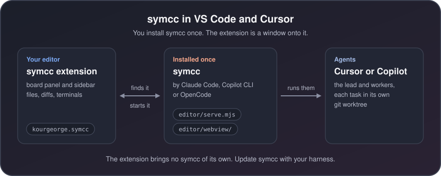

# Clients

symcc runs inside a program you already use: Claude Code (in the terminal or VS Code), OpenCode, Copilot CLI, VS Code or Cursor through the symcc extension, and it can be reached from chat apps. One section each.

## Claude Code

Claude Code is where symcc started, and where it has the most: the board panel, the band above the prompt, plan mode, sounds and voice. Install it as in [Get started](get-started.md); the [board](board.md) and [tasks](tasks.md) pages describe it.

## In VS Code

In the Claude Code extension's side panel, letter keys and ↑↓ do nothing: you click a button
(or Tab to it and press Enter). So the board there has its own layout; the terminal's is
unchanged.

- **Header**: the symcc logo (the clef, in the accent color) with one line beside it: the
  name, version and folder, then the board mode as plain bold words (`⏵ auto merge`).
  When another window drives the board, one notice row (no border) says so
  ("⚠ this window follows; /symcc-drive to drive from here"); click `/symcc-drive` to drive
  from this window. Under it the counts (`● 2 doing · ● 6 to do · ● 1 waiting for you`), each
  dot in its status color. Every line wraps, never cut. The setup facts (what the mode
  means, the branch, the tests and limits) are in the Live tab's **Status** section.
- **Tabs**: one line of text: `Live`, `Tasks 20`, `Scouts 1`, `Settings`. The tab shown is
  bold; the others are links, with their counts as plain words. No bar, no pill, no rule
  under them. Click a link to switch.
- **Style**: only real actions are buttons (Approve, Retry, Save, Send, ...), with at most
  one main (primary) button on a page. Going somewhere is a link. Headings are plain bold
  words, counts are plain dim words, and there are no pills, rules or hint lines. Only the
  Tasks list's Backlog, Done and Dropped headings still fold. The labels of a label and value list share one column, 11 characters wide.
  A link in a row sits in a cell of a set width, so it never drops onto a line of its own.
- **Live tab**: plain bold headings (`Status`, `Tasks 17 backlog`, `Branches`, `Today`) with
  the count as plain dim words. Nothing folds: no chevrons. One thin dim line
  separates each section from the next (none above the first or below the last, and a hidden
  section leaves no extra line). No blank rows.
  - **Status**: one row each. Mode (`⏵ auto merge · agents 0/3 busy`, with `change` as a link
    that switches the mode), Scouts (the running ones, a link to the Scouts tab; "none running"
    otherwise), Branch (and which window drives), Tests (short, then the time limit and retries).
  - **Tasks**: what needs you first, then the running lanes, **three lines each**: the mark
    (`▶`, or `✓` for a just-merged one), the id (a link that opens the task) and the whole title
    (cut with `…` only when the panel is too narrow), then, indented under the title, the train
    drawn with real lines and the time at the right (`3m`, `#2` in the queue, `merged 3m ago`). `try 2 · 3m` shows the try
    only when it is above 1. Under it a dim numbers line (`try 1/3 · ⌀ 2.7M (1.4×median) · worker 2.7M`, as in the terminal, without the time) with the task type at the right end, lined up with the time; the type is dropped when the row is too narrow. The station names ("work check queue tests done", with "you" when
    a task waits for you) are drawn once above all the lanes, so every train lines up under
    them. There is no legend line. A waiting task hangs under its lane as one line. When nothing
    runs it says why; when all is done: "✓ All done · last merged T-93 20h ago", then **Up next
    from the backlog** with the first 3 backlog tasks (each opens its page) and "14 more in the
    backlog" (a link that opens the Tasks tab with Backlog open). The one main button, `Tell the
    lead what to do next`, puts "Next task: " in the prompt box.
  - **Branches**: one line each, no graph: the id (a link that opens the task) in a cell of a set
    width, then its figures. `main` shows its newest commit and age (`c1c1c1c · 2 min ago`), a task
    its state and `+3 commits · 1 behind`, a merged one `merged 3m ago`. A figure that does not fit
    is cut with `…`, never wrapped onto a second line.
  - **Today**: label and value rows: Results (`✓ 0 merged · ↺ 0 sent back · ✗ 0 failed`, in
    green, yellow and red), Tokens (all of today's, then who spent them, all in one color),
    Agent time (and the cost when known), Per task, Hours (the day's token bars and the busiest
    hour), Yesterday, and 7 days.
  - **Organizational memory** `2 / 60`: one line, with an `All notes` link that opens the page
    of notes.
- **Tasks**: grouped under headings (Questions for you, Waiting for you, Review, Failed), each with
  its colored mark and its count as plain dim words (`? Questions for you 2`); doing and to-do tasks follow as one
  list with no heading (the task page's
  status is plain bold words in its color too), a blank line
  between them. Each task is one line: the ID (a link), its state cell (`▶ 2m`,
  `? waiting for 5m`, `✗ failed 3m ago`, lined up in one column per group), the whole title
  (cut with `…` only when the panel is too narrow), then dim words (the task type or role, the
  try, the question or why it failed). The search box is at the top; there is no mode switch
  here (it is on Live). A task that needs you starts with a `●` and has a
  bold title. The lead's questions look the same, in the warning color. Backlog, Done and
  Dropped are folded headings (`▸ Backlog  3 `), closed until you click them. With nothing
  open the list says "All clear" and has one main button, `Tell the lead what to do next`,
  which puts "Next task: " in the prompt box (only when the box is empty).
- **Footer**: on the VS Code Tasks tab there is no mode switch (it is on Live) and no search
  box (the search is at the top of the list, filters as you type, with `Clear search` while a
  search is on). No key hints and no hint line on any page; buttons drop the key marks
  (`Back`, not `Back (b)`).
- **A task's page** reads like a card. It uses the whole panel width and wraps every line,
  never cutting it with "…". From the top: the page header (see [the task page and the scout
  page](board.md#the-task-page-and-the-scout-page)): `‹` and a `Tasks` button back to the list, the
  `‹ 2 of 6 ›` pager, the task ID and title as a heading, the state as words (the mark in its
  color, then dim words: `◆` in green, then `answered: read it`, for an answered investigation), the action buttons in their groups (one
  style, no red; the one main action, such as `Approve`, `Retry` or `Pause`, is the primary
  button; needs review a button too), no divider. A scout's page does the same: `Run now`
  is its primary button.
  What needs you comes next, each under a bold heading with its mark in its color (no box, no
  border): the **Question for you** (yellow `?`) with its answers as numbered links and a
  box for your own answer (a file request has `Allow files` and `Don't allow`); **Why it
  failed** (red `✗`); **Waiting for your files** (yellow). The Run now question and the role
  list have no box either. Only a text box you type in keeps its own frame.
  Then the sections, each under a plain bold heading: **Details**, the same labelled rows as the
  terminal and OpenCode task pages (Steps, Added, Role, Type, From, Why, Files, Into,
  After, …, Tries, Priority) as a label and value list that wraps (its labels share the 11 character column), each task it waits for a link that
  opens it; the **Branch** (the task's branch against main, as on the terminal, in the
  monospaced font); the **Answer** of an investigation; **What to do** (the details, drawn as
  Markdown); the **Changes** of a task in review (and, once merged, of a done task); **History**, a timeline with the newest
  first (a mark on one line down the left, when it happened, then the whole line; merges in
  green, failures in red), the newest 10 with `Show all` for the rest; then one fold, closed
  until you click it, with the sum of the tries (as the Runs heading on the terminal):
  `▸ Time and cost 2 tries · 40m · 11.6k tokens`; and last the latest **Report** as Markdown:
  its first lines, with `Show all` for the rest and a button for each try.
- **Scouts**: one row per scout, with the same parts in the same order as the terminal list:
  its icon, its name (a link that opens it), how often it runs, its state (`running now`,
  `paused`, `next in 3h`, `on demand`), `last:` with the start of its last report
  (`last: found 2: …`, `last: nothing`) and its model. A row never wraps: its end is cut with
  "…" to fit. Under the list: `+ New scout`. With no scouts yet, a short how-to
  as plain text (no box) and `+ New scout` as the main button.
- **A scout's page**: the page header: `‹` and a `Scouts` button, and the pager; the name and its
  summary; when it runs, the next run, its model and the last run as plain words (no pills); buttons `Run now`
  (the main button; not while it runs), `Edit`, and `Pause` or `Resume` (`⏸ paused` beside it while paused);
  then its **Instructions** as Markdown, its **Runs** (one line per run, its time a link that opens its report), its **Results**, and its **File** (headings are plain bold text).
- **Settings**: every group is a plain bold heading (Work, Checks before merging, Workers, Scouts, Board
  and alerts) with its settings under it, each on its own row. The setting names share one label
  column, and the value sits beside it. A setting with a fixed set of choices (mode, notify, checker,
  scout_findings, tests_with_changes, open_on_start, enabled) is a drop-down: pick a value and it is
  saved at once. Numbers and the test commands are boxes: type and press `Save` (a wrong value says
  why and saves nothing; an empty test commands box clears them). Under each row, one dim line says
  what the setting does (no default or range). Roles and Task types are link rows with their count
  beside them; they open their pages. No help sentence under the list, no key hints.
- **Roles and Task types**: the page title is plain bold text (not blue), then the table. Where a
  role or task type comes from and `off` are plain dim words, not pills: the table's FROM column says
  `built-in`, `changed`, `added by you` or `off`, and a task type's own page says `built-in`,
  `replaced`, `added` or `off`. Remove asks inline, with no box: the question, a `Yes, remove` button and a `Cancel`
  link on one line.

## Using symcc in OpenCode

symcc also runs in [OpenCode](https://opencode.ai) 2.x (2.3 or newer). The older 1.x line has a different plugin system and is not supported (`opencode --version` tells you which one you have). This is a first version: the board, the lead, workers, scouts and the guard work; a few things are missing or differ from Claude Code (see [What differs from Claude Code](#what-differs-from-claude-code)). The Claude Code plugin is not changed by any of this, and both can be used on the same project.

### Install in OpenCode

**What you need:** OpenCode 2.3 or newer, git, and a copy of symcc. Nothing else is installed: symcc's `opencode/` folder has no packages of its own. Its board screen (the panel and the strip above the prompt) is drawn with Solid and OpenTUI, and OpenCode's window gives those to its plugins itself, so the board uses the very same copies as OpenCode's window (two copies of Solid would not work together).

**Getting OpenCode 2.x:** install it from npm, `npm install -g @opencode/cli` (the command is still `opencode`). Homebrew's `opencode` is the old 1.x line, which has a different plugin system and can't load symcc. Run `opencode --version` to see which one is on your PATH: it should say 2.3 or higher. The install script warns when it finds an older one.

From a copy of symcc on your machine (a clone, or the folder you already work in), one command:

```bash
git clone https://github.com/kourgeorge/symcc && sh symcc/scripts/install-opencode.sh
```

The script links symcc's `opencode/` folder into OpenCode's plugins folder for you, `~/.config/opencode/plugins/symcc` (or `$XDG_CONFIG_HOME/opencode/plugins/symcc`), so OpenCode loads it in every project. Nothing is copied or downloaded and there is no build step: OpenCode runs symcc's TypeScript files as they are, so a `git pull` in that folder updates symcc (restart OpenCode after it).

- **For one project only:** `sh symcc/scripts/install-opencode.sh --project <your project>` puts the link in `<your project>/.opencode/plugins/symcc` instead. Add `.opencode/plugins/` to that project's `.gitignore`, since the link points into your own machine.
- **Check it:** start OpenCode in your project and run `opencode plugin list`. OpenCode 2.3 lists the linked folder with no ID of its own (`ID: -   VERSION: local   SOURCE: <config>/opencode/plugins/symcc`), so `symcc` shows only in the folder path.
- **If OpenCode says "Plugin failed"** for symcc's folder: check `opencode --version` first (symcc needs 2.3 or newer). The board screen's error names the package it couldn't get from OpenCode (`solid-js` or `@opentui/solid`); OpenCode's log has it (`~/.local/share/opencode/log/`). Only the board screen stops then: the lead, its tools and the workers run in OpenCode's server part, which loads on its own.
- **Remove it:** the same command with `--remove` (and `--project <folder>` if you used it).
- **Keep the board local,** as in Claude Code: `echo ".symcc/" >> .gitignore`.

**Or with OpenCode's own command,** with no clone:

```bash
opencode plugin add github:kourgeorge/symcc
```

`opencode plugin add` takes an npm package or a git address with a `package.json` at its top. symcc's repository has one at its root (it only points OpenCode at `opencode/server.ts` and `opencode/tui.ts`; it installs nothing, and the Claude Code plugin doesn't use it). This works: in a scratch run with OpenCode 2.3.2, it printed `Plugin "github:kourgeorge/symcc" installed and added to ~/.config/opencode/opencode.json`, adding `"plugins": ["github:kourgeorge/symcc"]` there, and put symcc's files in OpenCode's cache, `~/.cache/opencode/npm/git-symcc-<hash>/<number>/node_modules/symcc`. OpenCode then loaded `opencode/server.ts` from there with no "Plugin failed", and `opencode plugin list` showed `symcc  932aaf3  github:kourgeorge/symcc` (the version is the commit it fetched).

- **The first `opencode plugin list` can say "No plugins found":** it starts OpenCode's background service, which is still loading plugins then. Run it again.
- **Updates:** this copy doesn't follow `git pull`; `opencode plugin check` and `opencode plugin update` fetch a newer one. Remove it with `opencode plugin remove github:kourgeorge/symcc`.
- **Use one way, not both:** with the script's link and this entry both in place, OpenCode can load two copies of symcc (not tried).

### The lead in OpenCode

The lead is the OpenCode session you type in, in your project's folder (or a folder inside it). There is nothing to start: talk to it as you would in Claude Code ("add a dark mode toggle", "what's going on?"). symcc gives it its guide on every request, and its tools as normal OpenCode tools (`symcc_board`, `symcc_add` and so on). Board updates come into its chat as a message: a normal one waits until its turn ends, and an urgent one (a worker needs you, or its time is up) is taken in mid-turn. When one of symcc's agents ends, OpenCode also posts its own "subagent completed" message; the lead is told to act on symcc's update only.

The slash commands are the same as in Claude Code: `/symcc` (the board), `/symcc-drive`, `/symcc-settings`, `/symcc-stats`, `/symcc-disable`, `/symcc-help` and the rest. They work the same in OpenCode's terminal and in its web page (`opencode web`). A command you type answers in a normal chat message, so its full text shows in both (OpenCode would show a quieter note only as a one-line label, and the web page's compact timeline hides those). That message also starts a short lead turn, and it tells the lead no reply is needed. The board panel's own key presses (approve, pause, answer...) stay quiet: their answer is a note that doesn't wake the lead. Opening the board panel (`/symcc-board`, and the panel opening after `/symcc-enable`) works only in the terminal; on the web page `/symcc` shows the board as text.

symcc's board runs in OpenCode's server, not in its window. By default the window uses OpenCode's background server (`opencode --standalone` starts a private one that ends with the window), so the board and its workers can keep running after you close the window. `opencode service stop` stops the background server, and the board with it; the next start picks the board up again.

### How workers run in OpenCode

Workers, scouts and checkers are OpenCode sessions of their own. Each one is a child of the lead's session and works in its task's own folder (a git worktree, as in Claude Code). The same checks guard them: an edit outside the task's files is refused, a shell command that writes into your own copy is refused (judged by the command's text, since OpenCode can't tell which files a command writes), and an agent symcc stopped is refused anything. Stopping a worker interrupts its session.

**The model per role.** Each role picks its model in its `model:` line, as in Claude Code (the built-in roles in `roles/`, your own in `.symcc/roles/<name>.md`; a scout in its scout file; a checker in the `checker` role):

- A Claude name (`sonnet`, `opus`, `haiku`, `claude-opus-4-5` ...) runs on OpenCode's own **Claude Agent** provider (`claude-agent/sonnet` ...). That provider runs the real Claude Code with your Claude Code login (`claude auth login`). Connect it once in OpenCode.
- **Any other model** OpenCode knows is written as `provider/model`, for example `model: openai/gpt-5`. You can mix them, for example Claude for the general role and a cheaper model for scouts.
- With no `model:` line (or `model: inherit` / `default`), the worker, scout or checker runs on **the model your lead session is using right now** (its provider and model), so it works with whatever OpenCode is set up for. The debug log says "(the lead's model)" on that agent's start line. Only if symcc can't find the lead's model (no lead session yet, or OpenCode didn't answer) does it fall back to `claude-agent/sonnet` for workers and `claude-agent/haiku` for checkers and scouts, and the log says so once.

**About the Claude login.** Whether using your Claude subscription login through OpenCode's Claude Agent provider is allowed is **not settled by Anthropic**. The Agent SDK's own docs say other products may not offer a claude.ai login unless Anthropic approved it, while a Claude Code team member later said nothing changed for Agent SDK use with Max plans; nobody has said publicly whether OpenCode's provider is fine. See the notes in the [OpenCode spike](research/opencode-spike-can-a-small-symcc-plugin-refuse-edits-start-a.md#is-the-claude-login-allowed-not-settled). Other models avoid the question: give your roles and scouts `provider/model` names (with that provider's own key). Or use symcc in Claude Code itself for Claude workers.

### The board panel and the strip

The board opens by itself in OpenCode's session panel, next to the session, the first time a session is shown, as in Claude Code at session start; turn the `open_on_start` setting off (`/symcc-settings open_on_start off`) to stop that. `/symcc-board` (or "symcc board" in OpenCode's command palette, ctrl+p) also opens it (run it again to close it; on OpenCode's home page, with no session open, a message says to open or start one first): the banner, then the tasks grouped as in Claude Code (Questions for you, NEEDS YOU, what runs and waits, the backlog, and Done and Dropped as counts), with the same marks, short states and times. The backlog shows its first 5 tasks and then "… N more (Enter to show all)": Enter or a click on that row lists the whole backlog. Open, Done lists today's finished tasks, then one folded row per older day ("▸ Yesterday · 6 done", "▸ Sun 15 Nov · 1 done"): Enter or a click on a day row opens or folds it. ↑/↓ (or k/j, on every page, a task's page too) move, Enter opens a task or a question, b goes back, [ and ] go to the previous and the next task (or scout) of the list on its page, Esc closes the panel. On a task in review, a approves and x rejects (it asks for the reason); on a waiting task or a question, a answers (pick a choice, or Answer… to type your own). A task's page has the same sections as Claude Code's task page, with the same headings: ▍Why it failed (a failed task), ▍Answer (an answered investigation), ▍Details, ▍Branch (its branch against main, see [the Branch section](board.md#the-branch-section)), ▍Changes (a task in review: its changed files; a done change task: the files its merge brought into main, read from the repository; a click on one shows the changes, like d), ▍What to do, ▍History, ▍Runs (the sum of its tries, then each try and its agents) and ▍Report (the latest try's, read from its file when you open the page). A task whose finished work waits only for your files shows ▍⧗ Waiting for your files (in yellow) above them: which files, "commit or stash them, it merges on its own", and that r (Merge now) merges it now. A question's page starts with "Q-3 Question for you" and a dim "asked by the lead · <when>" line, then Back, the question and its choices. A long history or report is cut after its first lines with "… (n more lines)" (the whole report stays in its file); the mouse wheel scrolls the page. A task's and a scout's page start with the same header as in Claude Code ([the task page and the scout page](board.md#the-task-page-and-the-scout-page)), which stays at the top while the page scrolls, and its thin rule sets it apart from the text. It offers the same actions as in Claude Code, with the same keys (p pause, u resume, r retry, o move to todo, z stash to backlog, v keep as a note (a button with no key on the Claude Code board), l role, h already merged, x drop, n needs review on/off); drop asks for an optional reason and role lets you pick from the roles. Only Copy and Watch worker are not there. These are sent as slash commands in your session (`/symcc-approve`, `/symcc-reject`, `/symcc-task T-5 pause` and the other `/symcc-task` words, `/symcc-answer T-5 <answer>` or `Q-3 <answer>`). You can type them yourself too, and all but `/symcc-answer` work in Claude Code as well: `/symcc-answer` is OpenCode only. In Claude Code you answer a waiting task or a question on the board (a on its page), or by telling the lead in the chat.

As in Claude Code, the panel has four tabs under the banner: Live, Tasks, Scouts and Settings (it opens on Live). l, t, s and c switch between them (or click a tab). Every screen has the same buttons as Claude Code's panel, and a click on one presses its key: the tab row, the list's mode (m) and search (f) buttons, Back (b) on the list pages (on a task's or scout's page, its header's `[Tasks]` or `[Scouts]`) and the buttons of a task's, scout's, role's or task type's page. The Tasks search works as in Claude Code: done and dropped tasks are found by words in their details and request too (read from their saved files while a search is on), and a task page opened from a search counts (`1 of 3`) and steps with [ and ] through only the matches. The header (banner, tabs and rule) shows only on the list pages (Tasks, Live, Scouts, Settings); an opened page has just its own buttons and text. **Live** (l) shows the same railway lanes as [the Live tab in Claude Code](board.md#live-tab), in the same sections: NEEDS YOU first (only while something waits for you), then TASKS (the lanes, with the waiting trains under them), BRANCHES, TODAY (today's numbers) and ORGANIZATIONAL MEMORY. The arrow keys reach the NEEDS YOU rows first, then the lanes, trains and Branches rows, and Enter (or a click) opens that row's task or question (there is no `w` key to watch a worker). Back (b) from a task opened on Live returns to Live, on its lane. At the bottom of Live, the **Organizational memory** section (the count, the 3 newest notes and the topics with their counts) opens the notes the agents keep: the arrow keys reach its notes and topics too, Enter on a topic opens only that topic's notes, Enter on a newest note opens all notes with the cursor on it, and Enter (or a click) on the `[all]` button next to `newest` opens all notes. There, x deletes the note under the cursor after a yes (sent as `/symcc-settings orgmem delete N`), and b returns to Live. **Scouts** lists each scout with how often it runs, whether it is paused or when it runs next, and its last result; Enter opens a scout's page: its instructions, its recent runs (newest first, with the tasks made from them) and its file. On it, r runs the scout now and p pauses or resumes it (sent as `/symcc-scout <name>` and `/symcc-scout <name> pause` or `resume`), f moves its findings choice on (board default → auto → backlog, sent as `/symcc-scout <name> findings auto`, `backlog` or `default`; the list's top line says the board default and each row the scout's choice), and e edits it: pick how often it runs, its model or its instructions, then type the new value (sent as `/symcc-scout <name> every 30`, `model <model>` or `model none` for the session's model, or `prompt <instructions>`; the rest of the scout's file is kept, and longer instructions are easier to write in the file itself). Enter on a run shows its report, and b goes back. **Settings** shows every setting in the same groups and the same clean list as Claude Code: a row is the setting's plain name, dots, then its value ("Workers at once ..... 3", "Time per worker ..... 45 min"), and a closed group is its title with its values in short after it (on a narrow panel "▸ Work · auto · 3 at once"). Under a thin rule, the row under the cursor is explained: its name, what it does, then the name to use in `/symcc-settings`, its default and its range (a group heading shows a line about the group). Enter (or a click) changes the one under the cursor: on/off settings flip, mode, notify, scout_findings and tests_with_changes are picked from a list, and the rest are typed; it is sent as `/symcc-settings <name> <value>`. Under Workers, the Roles and Task types rows (with how many there are, and how many are off) open their pages, as in Claude Code: a table of the roles or task types, one line each (NAME, FROM, and for a role MODEL, WEB and WRITES, then WHAT IT'S FOR, cut to fit; the cursor's line marked `❯`), and a file that can't be read says why. Enter opens one: its description, what a role writes (`Writes: code ...`), a role's model, skills and tools, its checklist (a role) or body (a task type), a role's placeholders (the `{{placeholders}}` its checklist may use, and what each becomes), and its file. On it, o turns it off or on and r resets it to the built-in one (when you changed a built-in); these are sent as `/symcc-settings role <name> off` (or `on`, `reset`; `type <name> ...` for a task type). general, the checker role, change and investigation can't be turned off. As in Claude Code, a role's page has the shared page header (‹ [Roles], [ and ] for the role before or after it, its state such as `replaced · 1 change`, and the buttons [Edit] (e; its edit page has Save and Cancel), [Prompt] (p), [Turn off] or [Turn on] (o), [Reset to built-in] (r; it asks first) and [Remove] (d; it asks first, and only for ones you added)), then its **Changed from built-in** section; a task type's page has Back, Edit, Turn off or Turn on, Reset to built-in and Remove. The list pages have **+ New role (n)** / **+ New task type (n)**, a role's edit page has a **Writes** box that Enter switches between code and prose only (sent as `code` with the save), and the Scouts page has **+ New scout** (n). They are sent as `/symcc-settings role <name> add`, `edit <field> <value>`, `save {...}` and `remove` (the same for `type`), and `/symcc-scout <name> new <instructions>`. When the folder has no git repo or no commit yet, the banner shows **Set up git (g)**, which asks for a yes and sends `/symcc-settings git setup`. When git is not installed it shows the install step and **Check again (g)** (`/symcc-settings git check`); while git is missing symcc does not try git again by itself (on a Mac, each try would bring up Apple's install pop-up), so press it after installing git. With no repo or no commits, symcc looks again every 2 minutes, so a `git init` and a first commit by hand clear the notice. Opening the panel sends nothing into the chat. A change you make in a file yourself shows in the panel at the next board change (OpenCode tells symcc of no finished edit). b goes back one page.

Above the prompt of an open session, a strip shows the header line and the questions and tasks that need you or run, as the band does in Claude Code. It is there by itself; there is nothing to turn on. Click its header line to open the board panel (click again to close it), or click a task's or question's row to open its page; the header ends with a dim "(click: board)" when there is room.

The panel reads `.symcc/view.json` once a second; the board writes that file on every change (also when the lead's roles or task types tool changes one), with each scout's recent runs, the roles and task types, and the changed files of each task in review (a run's or a task's report is read from its own file when you open it). Plain `/symcc` prints the board as text in the chat, as in a window without the panel; `/symcc-tasks` prints the short task list and `/symcc-status` the Live tab as text, as in Claude Code.

**If you see no strip and no panel:** open a session first (the strip and the panel belong to a session, not to OpenCode's home page), and restart OpenCode's window after updating symcc. If the board screen can't start or draw, a red message from symcc says why, and `/plugins` lists symcc as failed with the error; the lead, its tools and the workers keep running either way.

### What differs from Claude Code

- **Cost shows 0 on subscription and free models.** OpenCode reports a cost of 0 for them, so the stats show tokens only.
- **The lead's tokens.** `/symcc-stats` with no range counts the lead session's whole total, as OpenCode tells it. A ranged one (`7d`, `T-100..T-130`) counts each answer of the lead's session with its own tokens, at the time it finished, if it falls inside the range. OpenCode lists only the answers since the session's last compaction, so after a compaction the tokens from before it have no dates: a ranged call leaves them out and says how many there are ("from before the last compaction, not dated"), next to where the lead's tokens come from. If OpenCode can't list the answers, a ranged call leaves the lead out and says why.
- **No hooks for some things.** symcc doesn't follow OpenCode's Plan agent (there is no plan mode for it to see), it can't open the panel by itself when OpenCode starts (use `/symcc-board`), and it judges a shell command only by its text. Workers can't use OpenCode's `question` tool (nobody watches their sessions to answer it); they use `symcc_ask_owner`, as in Claude Code.
- **Not built yet:** workers as separate `claude -p` or `codex exec` processes.
- **When OpenCode stops.** OpenCode 2.3 lets symcc clean up when its server is stopped normally (also with Ctrl-C or `kill`), so the next start, in OpenCode or in Claude Code, drives the board at once. If it was killed hard or crashed, `.symcc/lead.json` stays behind; the next start then follows until that file is 3 minutes old, and takes over by itself, as after a Claude Code crash.

### How it works inside

- **One copy runs the board.** OpenCode starts the plugin once for each folder a session works in, workers' folders too. Only the copy for the project's main folder runs symcc's engine: it takes the lead (`.symcc/lead.json`, the same lock as in Claude Code), starts the timers and seeds the scouts. The copies in workers' folders only guard. If two copies point at the same real folder (on macOS, `/tmp/...` and `/private/tmp/...`), the first one runs the board and the other takes over when the first is unloaded.
- **Edits are guarded** through OpenCode's permission check, with symcc's usual checks. A tool-call hook stays behind it as a backstop: it reads OpenCode 2.3's own tools that change files (`edit` and `write` with a `path`, `patch` with its patch text, and `shell` with its command and folder), plus a `multiedit` tool if a plugin adds one. So far these refusals are covered by symcc's tests with a stand-in for OpenCode's session API; a check in a real OpenCode run (a worker's folder copy refusing an edit outside its files, and a real `patch` call) is still to be done.
- **Starting a worker.** symcc makes the session a child of the lead's (the last session in your project folder you typed in), moves it into its task's folder and waits until OpenCode shows it there (a child session first opens in its parent's folder), and only then gives it its prompt, once the board names it, so the guard in that folder knows it. When it ends, symcc reads its final answer and its tokens.
- **The lead** is never a child session or one of symcc's own. symcc remembers it for the project while OpenCode runs, also across plugin reloads. As in Claude Code, reports close together go in one update, your own board actions wait as "Meanwhile" lines, and starting a worker sends nothing. An update sent before you have typed anywhere waits for your first prompt.
- **Tools per session.** Each session is offered only what it may use: a worker only `symcc_ask_owner`, a scout or a checker only `symcc_board` and `symcc_stats`; a call of anything else is refused. The tools are normal OpenCode tools, not hidden in OpenCode's Code Mode. A command's answer meant only for you comes as a normal chat message (it starts a short lead turn), or, for a board panel key press, as a note that doesn't wake the model. Where the TUI part doesn't take `/symcc`, `/symcc-help` leaves out the Claude panel's keys and lines.
- **The panel** runs in OpenCode's TUI, apart from the server part, so it draws from `.symcc/view.json`. It takes Solid and OpenTUI from OpenCode: OpenCode 2.3 swaps the plain names `solid-js` and `@opentui/solid` in a plugin's files for its own copies, so `opencode/tui.ts` writes them out in its `import()` calls (a name kept in a variable isn't swapped and fails with "Cannot find package 'solid-js'"), and `loadTuiRuntime` in `hooks/opencode/tui.ts` gives an error naming the package when one is missing.

The code is in `hooks/opencode/` and `opencode/`; `sh scripts/test-opencode-host.sh` runs its tests (with a stand-in for OpenCode; OpenCode itself is not needed).

## Using symcc in Copilot CLI

symcc also runs in [GitHub Copilot CLI](https://docs.github.com/copilot/how-tos/copilot-cli) as an extension (tried with Copilot CLI 1.0.114). This is a first version: the lead's tools, the `/symcc` commands, the board as text, workers, scouts and checkers work; there is no board panel yet. The Claude Code and OpenCode plugins are not changed by it.

### Install in Copilot CLI

Copilot extensions are still experimental, so start Copilot with `copilot --experimental` (or turn it on once inside Copilot with `/settings experimental on`). Without it, symcc is installed but doesn't load.

Add symcc's repository as a marketplace, then install the plugin from it:

```bash
copilot plugin marketplace add kourgeorge/symcc
copilot plugin install symcc@symcc
```

The marketplace file is `.github/plugin/marketplace.json`, and the plugin's manifest is `.github/plugin/plugin.json`. The plugin is the whole repository: its extension, `copilot/extensions/symcc/extension.mjs`, reads symcc's roles, task types and example scouts from the folders beside it. Copilot can also install straight from the repository (`copilot plugin install kourgeorge/symcc`), but it warns that such direct installs will stop working in a later release, so use the marketplace. For a local copy (a clone you work in), `copilot plugin marketplace add <folder>` works too: Copilot then loads symcc live from that folder, with nothing copied.

- **Check it:** `copilot plugin list` shows `symcc@symcc`. In a session, ask the lead to call `symcc_board`: in a folder with no board yet it answers "no symcc board in this folder · /symcc-init to create one here".
- **The first start in a folder** asks you to trust it ("Confirm folder trust"). Say yes, or Copilot loads no extension there.
- **Updates:** `copilot plugin marketplace update symcc`, then `copilot plugin update symcc@symcc`. Remove it with `copilot plugin uninstall symcc@symcc`.
- **Keep the board local,** as in Claude Code: `echo ".symcc/" >> .gitignore`.

### Show symcc's status line in Copilot's terminal

Copilot CLI can draw a status line under its prompt from a command you name. symcc ships one, `hooks/copilot/band.ts`, that prints the same one line Claude Code shows (for example `symcc: ⏵ auto merge · ...`). It needs [bun](https://bun.sh); plain Node can't run it.

Add this to `~/.copilot/settings.json`, with `<plugin folder>` being the folder symcc is in (your clone, or where Copilot installed it):

```json
"statusLine": { "type": "command", "command": "bun <plugin folder>/hooks/copilot/band.ts" }
```

The command looks for `.symcc/board.json` in the folder Copilot runs it from, then in each folder above. Outside a symcc project it prints nothing. Two optional environment variables change what it shows:

- `SYMCC_ROOT=<project folder>`: use this project when Copilot runs the command from some other folder.
- `SYMCC_SESSION=<session id>`: this window's session id. With it, a window that doesn't drive the lead shows who does. Without it, the line always says this window drives.

For example: `"command": "SYMCC_ROOT=/path/to/project bun <plugin folder>/hooks/copilot/band.ts"`.

Limits:

- It never shows when the next scout starts ("next scout X in Nm"): those times live only inside the running symcc, not in files on disk.
- The branch comes only from a plain `.git` folder (its `.git/HEAD` file). Where `.git` is a file, as in a git worktree, no branch is shown.
- It shows in Copilot's terminal only, not in the Copilot desktop app.

### Your own model provider (BYOK)

- The `COPILOT_PROVIDER_*` and `COPILOT_MODEL` variables you start Copilot with reach symcc's workers, scouts and checkers too (each runs in a copilot process of its own, started with the extension's environment).
- Copilot keeps secret variables away from extensions. When `COPILOT_PROVIDER_API_KEY` or `COPILOT_PROVIDER_BEARER_TOKEN` is set, Copilot asks once whether symcc may have them, so its agents can use your provider. If you say no, Copilot doesn't load symcc at all.
- A role's or scout's `model:` line (`sonnet`, `haiku` ...) is passed to Copilot as it is. To map symcc's names to your own model ids, set `SYMCC_COPILOT_MODELS="sonnet=<id>,haiku=<id>"`. With no `model:` line, Copilot picks the model (or uses `COPILOT_MODEL`).

### What works and what doesn't yet

- **Works:** the lead's tools (`symcc_board`, `symcc_add` and the rest), board updates that wake the lead (a normal one when it is idle or at the end of its turn, an urgent one at its next tool call), workers, scouts and checkers as Copilot sessions of their own, each in its task's worktree with symcc's guard on its edits and shell commands.
- **No board panel:** the status line is opt-in (see [Show symcc's status line in Copilot's terminal](#show-symccs-status-line-in-copilots-terminal)). `/symcc` prints the board as text in the chat, `/symcc-tasks` the short list and `/symcc-status` the Live tab.
- **`copilot -p` needs `--allow-all`:** in `-p` mode there is nobody to approve an extension, so Copilot loads no extension at all, symcc included: no `symcc_*` tools and no `/symcc` commands. It prints "Denied, no one to approve extension permission (plugin:symcc:symcc)". Add `--allow-all` (or `--allow-all-tools`), for example `copilot --experimental --allow-all -p "Call the symcc_board tool"`; then the tools work. Even then, a `/symcc ...` prompt in `-p` goes to the model as plain text, so ask the lead in words ("show the board"). The interactive CLI needs neither.
- **After `/clear`** Copilot restarts the extension; the board and the lead's lock are on disk, so symcc picks up where it was.
- **Check that a worker's shell runs in its worktree:** symcc rewrites each of an agent's shell commands to run from the agent's own folder. A worker told to run `cd / ; pwd` should still print its worktree's path (`.symcc/worktrees/T-n`), not `/`.

### Building the extension

Copilot runs one JavaScript file per extension, so symcc's TypeScript is bundled: `sh scripts/build-copilot.sh` builds `copilot/entry.ts` (which gives the Node parts and the Copilot SDK to `hooks/copilot/`) into `copilot/extensions/symcc/extension.mjs`. The SDK (`@microsoft/copilot-sdk` and `@microsoft/copilot-sdk/extension`) is left out of the bundle: Copilot gives it to every extension. The built file is committed, since an install from GitHub copies the repository as it is and runs no build step. So rebuild it after engine changes, before a release: `sh scripts/build-copilot.sh --check` says whether the committed file is out of date. `sh tests/copilot-bundle.sh` builds it into a scratch folder, runs it against a stand-in SDK, and checks the manifest and the marketplace file. The manifest's `"hooks": "copilot/hooks.json"` points Copilot at an empty hooks file; without it Copilot would read Claude Code's `hooks/hooks.json` and log "Invalid hooks config" on every start. Paths in `.github/plugin/plugin.json` are read from the repository root.

## Using symcc in VS Code and Cursor

The symcc extension (`kourgeorge.symcc`, on the VS Code Marketplace and Open VSX) shows the board, a sidebar and the lead's chat in VS Code or Cursor. The agents are Cursor's or GitHub Copilot's. The extension brings no symcc of its own: it runs the symcc you installed with Claude Code, Copilot CLI or OpenCode. Nothing changes for those harnesses.



### Install in VS Code or Cursor

1. Install symcc with a harness, if you haven't: [Get started](get-started.md), [Install in Copilot CLI](#install-in-copilot-cli), or [Using symcc in OpenCode](#using-symcc-in-opencode). A clone of the repository works too.
2. Install the extension: search for **symcc** in the editor's Extensions view, or run `code --install-extension kourgeorge.symcc` (`cursor --install-extension kourgeorge.symcc` in Cursor).
3. Open a project folder that is a git repository, and click the symcc icon in the activity bar.

It needs VS Code 1.101 or newer, or a Cursor built on it: symcc needs Node 22.13 or newer, and these editors bring it. With an older editor, set `symcc.nodePath` to a Node 22.13 or newer.

### How it finds symcc

- First the folder in `symcc.pluginPath`, when you set one.
- Else the copies the harnesses installed: Claude Code's installed plugins, Copilot CLI's installed plugins and a folder you added as its marketplace, then OpenCode's plugin link and its plugin cache.
- It runs the newest copy whose editor files speak its protocol number (see [The contract and its number](architecture.md#the-contract-and-its-number)). The status bar item's tooltip says which, for example "symcc 0.5.42 from Claude Code". **symcc: Show the log** lists every copy it found.
- When it finds none, the sidebar shows the install commands, **Look again**, and **Choose the symcc folder**.
- When the copy is too old (from before symcc had editor files) or too new for the extension, one message says what to update: the plugin, with your harness's update command, or the extension.

After you update symcc, run **symcc: Restart symcc**.

### The agents

- **Cursor's** (`"symcc.agents": "cursor"`, the default): set `CURSOR_API_KEY`, or use a login the Cursor SDK saved in `~/.cursor/sdk/auth.json`. The Cursor SDK's license keeps it out of symcc, so the first run downloads it from npm (pinned versions, each checked against its hash) into a cache folder: `~/.cache/symcc` on Linux, `~/Library/Caches/symcc` on macOS, `%LOCALAPPDATA%\symcc\Cache` on Windows. `SYMCC_CACHE` moves it, and `SYMCC_NPM_REGISTRY` names an npm mirror.
- **GitHub Copilot's** (`"symcc.agents": "copilot"`): install the Copilot CLI and run `copilot login` once (or set `GH_TOKEN`). symcc runs that CLI. If the CLI speaks another protocol than symcc's Copilot SDK, symcc says so, with the command that updates the CLI or symcc.
- You can also pick the agents in the board's model menu. symcc restarts with them.
- Behind a proxy: `symcc.proxy`, else the editor's `http.proxy`, else `HTTPS_PROXY`.

### Using it

- **symcc: Set up symcc in this project** (or `/symcc-init` to the lead) creates the board. Then tell the lead what you want done.
- The panel has the Now, Board, Worktrees, Scouts and Memory pages. The sidebar shows the board at a glance, and its badge counts what needs you.
- On the Board page, a task shows what it has done so far, its change size, its history with who wrote each line, and its checker's report.
- When another window drives the board, the header says so. **Drive here** makes this window drive it.
- **symcc: Message the lead** sends the lead a message from anywhere.
- The settings are `symcc.agents`, `symcc.leadModel`, `symcc.workerModel`, `symcc.pluginPath`, `symcc.nodePath`, `symcc.proxy` and `symcc.notify`.

### Building it

The extension runs the plugin's `editor/serve.mjs` and shows its `editor/webview/`. Both are built from `hosts/cursor/` and committed, like the Copilot CLI extension: `sh scripts/build-editor.sh` rebuilds them, and `--check` says whether the committed files are out of date. To work on the extension, open the repository in VS Code or Cursor and press F5 (**symcc: Cursor extension**): it runs this clone's `hosts/cursor/dist/engine.mjs` and its own webview build. How the extension and the plugin are released: [Releasing](releasing.md).

## Chat apps

You can also talk to the lead from a chat app instead of the terminal.

### Using symcc from Slack through DAM

DAM runs a Claude Code session from a Slack thread (one thread is one session). DAM sets
`PLATFORM_HARNESS=claude-code` everywhere in its image, terminal windows too, so that alone
is not enough: symcc treats a session as a Slack session only when it also runs through
DAM's chat program (`CLAUDE_CODE_EXECUTABLE` ends in `harness-claude`), or once a Slack
message from you has arrived in it. A DAM terminal window gets plain board updates.

What works:

- **Board news reaches Slack.** DAM only sends to Slack what the lead posts with DAM's own
  tools; a plain reply is dropped. So in a DAM session every board update (merges, failures,
  and every "needs you": a worker's question, a review, more time, an answered
  investigation) ends with a line telling the lead to post its short reply to the Slack
  thread with DAM's reply tool (or DAM's post tool when there is no thread).
- **The lead knows its job.** DAM may skip the hook that gives the lead its guide, so each
  board update there also carries a short core of it: the reply shape and the main rules.
- **Your Slack messages count as yours.** A task the lead adds after your Slack message
  links back to your words, like a message typed at the terminal.
- **A window that doesn't drive still takes tasks.** If another window drives the board,
  the lead in this one still adds, changes, drops, approves and answers tasks as usual; the
  driving window runs the workers, scouts and merges. Use /symcc-drive only when you want
  this window to run the work itself.

What doesn't work yet: while DAM's session sleeps between messages, nothing runs on its
own there: no scouts and no two-minute check. Work moves on when the next message wakes it.

### From a chat app

When you talk to the lead from a chat app (a Claude Code channel such as Telegram, Discord or
Slack), symcc notices it from your message and switches to chat mode (DAM's Slack sessions use
the same mode):

- **Your messages count as yours**, like a message typed at the terminal.
- **Board news reaches the chat.** A chat only sees what the lead sends with that chat's reply
  tool, so every board update that wants a reply (and the lead's guide) ends with a line telling
  the lead to post its short reply with the reply tool of that server (for example telegram).
- **Questions are numbered text.** The lead never opens a pop-up there (you can't see it): it asks
  in one sentence, numbers the choices and says "reply with the number or your own words".
  The question is still on the board too.
- **Short views.** The tasks list, the status, the board text and one task's page use one short
  shape there: plain lines (no columns, rules or bars), one task per line like
  `T-5 running: test, try 2, 12m: title`, "Needs you" first, the backlog only as a count, and at
  most 3,500 characters. A long text is split into pages: a "+N more" line says what is left, and when you say "more" (or "more tasks") the lead asks for the next page and posts it. For one task, `/symcc-task T-5 more` (or `page 2`) gives the next page. A long question is shortened with "…", but it always keeps every numbered choice.
- **Plain words work.** Slash commands may not reach symcc from a chat app, so the lead has the
  same views as a tool: ask "status", "tasks", "what's running" or "show T-5" and it posts the same
  text as `/symcc-status`, `/symcc-tasks` or `/symcc-task T-5`.
- **The board as a picture.** Ask for the board as a picture and the lead makes one web page
  (`.symcc/board.html`, no scripts or outside files, fine on a phone, light and dark) with the board tool's
  `view: "html"` and sends the file with the chat's reply tool (Telegram's reply takes files). On the
  computer, `/symcc-board html` writes the same page and opens it.
- **Back at the terminal.** When you next type at the terminal, chat mode goes off.
