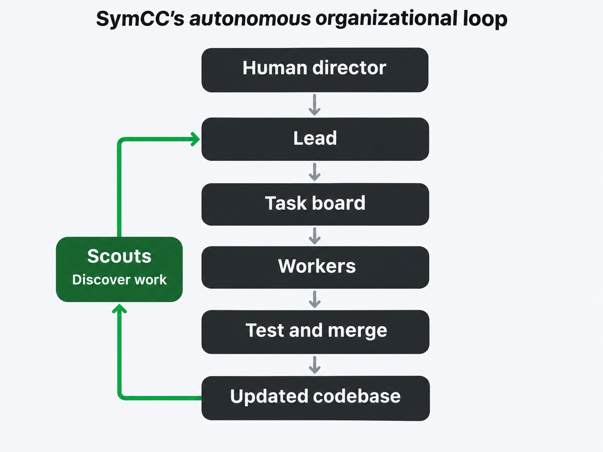

# How it works

The parts of symcc, what each one is called, and the path a task takes from your words to a merge.

## The parts and their names

The same names are used in the rest of the documentation.

| Name | Known term | What it does |
|---|---|---|
| **You** (the owner) | The human in the loop | Say what you want, answer questions, approve or reject |
| **Lead** | Orchestrator agent (your normal Claude Code chat) | Plans, breaks work into tasks, supervises the workers, decides what to do when something fails, reports to you |
| **Board** | Task board (a plain file at `.symcc/board.json`) | One board (todo / doing / review / done) for requested work (from you) and discovered work (from scouts) |
| **Workers** | Parallel agents (one per task) | Each builds one task in an isolated git worktree on its own branch, then stops |
| **Scouts** (optional) | Scheduled background agents for discovery | On a timer, look for bugs, missing tests, outdated dependencies or security notices, and report to the lead; symcc refuses their file edits and git writes in the project (see [scouts](scouts.md#scouts)) |

And the ideas that tie them together:

| Term | What it means here |
|---|---|
| **Discovery → triage → implementation → review → merge** | A scout or you find work, the lead puts it on the board, a worker builds it, you review it, symcc merges it |
| **Scope check** | Each task lists the files it may change (its scope); anything else is not merged; a worker's edit outside it is refused and becomes a file request to you |
| **Automatic retries** | Failing tests, or a clash with your branch, send the task back to a new worker (with the failing test output, or told to merge your branch in first), up to `auto_retries` times in all (2 by default) |
| **Test gate** | Your test commands must pass before anything is merged |
| **Approval before merge** | Human-in-the-loop review: modes auto merge, approve merge or paused; see the diff, approve, or reject with a reason; one task can be marked "needs review" |
| **Merge into the target branch** | Commit, scope check, update on the latest target branch, re-run tests, then merge; your branch only moves this way |
| **Live status** | The board panel and the status line |

symcc is proactive while your Claude Code session is open. Work stops when you close it and
picks up again next time. There is no extra app and no link to an issue tracker: the board is a
plain file in your project. When two changes clash, a new worker sorts out the clash.

## Pictures and the video



<p align="center">
  <a href="video/symcc.mp4"></a>
  <br>
  <a href="video/symcc.mp4"><b>Watch the full video</b></a> (78 seconds, no sound)
</p>

In short: you ask, or a scout finds something. The lead makes tasks and sets their order and
files. Workers build in parallel. symcc checks the files and runs your tests, you review, and it
merges. The [steps in full](reference.md#how-it-works-step-by-step) and [A task's life](#a-tasks-life)
have the rest.



### Why it is built this way

Each part is there for a reason. Knowing it makes the rest of the documentation easier to follow.

- **A lead, so you talk to one place.** Ideas come at any time. The lead takes them without
  stopping the work that is running, turns them into tasks and decides the order. Without it, you
  would split the work, track it and start each agent yourself.
- **Workers, each with its own folder and file list.** Workers run side by side. A separate git
  folder and branch per task keeps them from overwriting each other, and keeps your own branch
  untouched until a merge. The file list (the scope) is what makes the check possible: an edit
  outside it is refused and becomes a question to you, instead of a surprise in the diff.
- **Scouts, so work is found while you are away.** They only read. Anything they find goes to the
  lead as a note, and becomes a task only if the lead adds it, so a scout can never change your
  project by itself.
- **A checker (optional), a second pair of eyes.** A fresh agent that did not write the change
  tries to break it before it reaches the tests. It is off by default because it costs time and
  tokens. It sends work back only for what is worse than main; gaps main already has are listed
  as follow-ups. After two send-backs the task waits for you: Merge as is (tests, no checker),
  Keep fixing (one more try) or Drop.
- **One merge queue.** Finished tasks take turns. Only the task at the front catches up with
  your branch, runs the tests and merges, so your branch cannot move in between and the code
  that was tested is exactly the code that merges. Before the queue, several tasks could merge
  into a moving branch at once, and each had to catch up, test again and sometimes clash with the
  others. Now no two merges race and no test run is wasted. One rule covers every way into a
  merge (hand-back, approve, retry), so it is simple to follow and to trust. The cost is waiting:
  see [the queue](tasks.md#states-stages-and-the-queue).
- **Guards that stop honest mistakes.** symcc refuses a scout's or checker's file edit and git
  writes, and a worker's edit outside its file list. These checks read the command text. They
  catch a worker that makes a mistake. They are not a security boundary and do not stop an agent
  that works around them on purpose.
- **Org-mem goes through the lead.** Agents only suggest notes at the end of a report. The lead
  decides which ones to keep, so the shared file stays short (60 lines at most), free of repeats,
  and free of notes that only matter for one task.
- **Investigations wait for you.** An investigation is a question, and the answer is for you. Even
  in `auto` mode it ends only when you read it and pick Done, Keep as a note or Ask more.

## A task's life

```
            ┌──────────────── retry / change ──────────────┐
            ▼                                              │
  todo ──▶ doing ──▶ checks + tests pass ──▶ done          │
   ▲         │                                             │
   │         ├──▶ tests fail ──▶ back to todo with the      │
   │         │    failing output (up to 2 times by itself)  │
   │         ├──▶ still failing / out of time ──▶ failed ───┘
   │         ├──▶ worker's edit outside its list refused ──▶ waiting (file request)
   │         ├──▶ worker asks (ask_owner tool) ──▶ waiting, "symcc: T-5 needs you"
   │         ├──▶ worker's run ends on an error or a refusal ──▶ failed (with the reason)
   │         └──▶ worker ended its turn with no report while its own
   │              background command still ran ──▶ failed (with a report,
   │              symcc stops the command and checks as usual)
   │
   ├── review   (only in approve merge mode) checks passed; waits for YOUR approve
   │            (merge) or reject with a reason (back to todo, fresh worker)
   ├── waiting  the lead or a worker asked YOU something; your answer sends it
   │            back to work
   ├── paused   stopped on purpose; "resume" sends it back
   ├── dropped  cancelled; stays on the list and never runs on its own;
   │            retry (r on its page, or ask the lead) brings it back to todo
   └── backlog  a parked idea or unclear work; never starts until you move it
                to todo ("move T-5 to todo"); "stash" (z on its page) sends a todo, paused or
                failed task back here
```

| Status | Meaning |
|---|---|
| `todo` | Ready to be picked up (once the tasks it waits for are done) |
| `doing` | A worker is on it right now |
| `waiting` | It needs an answer from you (shown under NEEDS YOU) |
| `review` | Ready for review: the worker is done and the checks passed, but nothing is merged until you approve it. Once you approve, the task leaves NEEDS YOU and shows with the running tasks (prep, queue, test, merge) until the merge ends |
| `paused` | Stopped on purpose, until resumed |
| `failed` | It could not be finished; the lead decides what next. Its page starts with a "Why it failed" block: one plain sentence for the reason (tests failed, the checker found problems, files outside the task, no change, no result, out of time, an API error or refusal, the worker ended its turn before its work finished, could not start, a merge conflict), what the worker's report asks for (a `NEED FILES:` line or a question), and what to do next (Retry, ask the lead in the chat to change the task, or Drop). Its key line lists `r retry` and `x drop`. The board row and the lead's board show the same sentence |
| `done` | Merged into your branch. This is final |
| `dropped` | Cancelled. It never runs on its own; retry brings it back to todo on purpose |
| `backlog` | A parked idea or unclear work. It never starts until you move it to todo. In the board panel it sits in a folded "▸ Backlog  N" row below the active tasks |

## Working with several repos

One board can sit in a folder that holds several repos. Each task names the repo it belongs to (its project). The worker
gets a copy of that repo, the checks and the tests run there with that repo's own test command, and the change merges
into that repo only. See [Projects: a folder with several repos](running-on-its-own.md#projects-a-folder-with-several-repos).

## Scouts at work

Examples of what scouts do while you are away:

- A **gaps** scout finds a function with no tests. The lead adds a task, a tester worker writes
  the test, the tests pass, it merges.
- A **dependencies** scout finds an outdated package with a security notice. The lead adds a
  task, a worker updates it and runs your tests. You review the diff.
- A **bugs** scout finds a missing null check. The lead adds a bug task, a worker fixes it. If
  the fix needs a choice (say, which error to show), it asks you.

The lead keeps it moving; you come back to merged work and a few questions.

## How symcc is different

**Coding agents** (Claude Code, Codex, OpenCode, Goose) run one agent you talk to. Their helper
agents work inside your turn, and you wait for them. Nothing keeps a list of the work after the
chat ends. symcc adds a team on top: a lead you talk to, a board that stays between sessions,
workers that build in the background, and scouts that look for problems on their own.

**Multi-agent apps** (claudecodeui, T3 Code, cmux and others) let you run several agents side by
side, but *you* split the work, keep track of it, check it and merge it. In symcc the lead does
that. It turns what you say into tasks, decides their order, starts the workers, runs your
tests, merges what passes, and asks you only when the decision is really yours.

Put together, only in symcc:

- every task remembers who asked for it and why ([tracing a task back](board.md#tracing-a-task-back))
- each worker gets its own copy of the code and may change only its own files
- nothing merges unless the tests pass; optionally, a checker tries to break each change first
- questions come back as answers, and never as code changes ([investigation tasks](tasks.md#investigation-tasks))
- scouts, retries and a health check keep the work going without you pushing it

**Where it runs.** symcc runs inside Claude Code, OpenCode, Copilot CLI, and VS Code or Cursor
(see [Clients](clients.md)). Work runs while your session is open. A small command-line version
that runs the same engine without a chat window exists as a test of the idea (see
[Running symcc without Claude Code](architecture.md#running-symcc-without-claude-code)).

## Read more

- [Tasks](tasks.md): the states, stages and merge queue in full, and what happens when a worker finishes.
- [The board](board.md): the panel, the task page and the Live tab.
- [Scouts](scouts.md): agents that find work on a timer.
- [The documentation](docs.md): every page, in one list.
