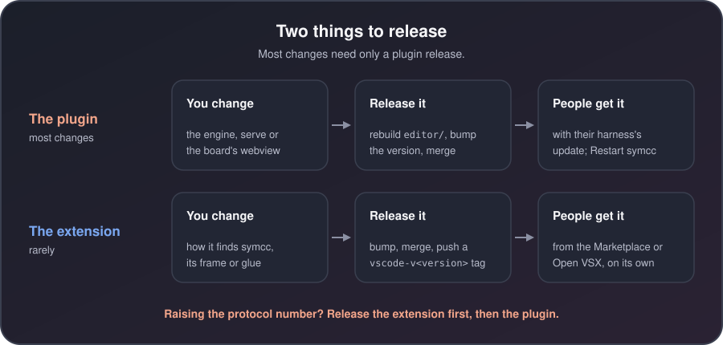

# Releasing

For people who release symcc. symcc has two things to release, on two tracks:

| What | Where it lives | How people get it | How you release it |
|---|---|---|---|
| The plugin | the whole repository | Claude Code, Copilot CLI or OpenCode installs it | bump its version, merge to `main` |
| The extension (`kourgeorge.symcc`) | `hosts/vscode/extension/` | the VS Code Marketplace or Open VSX | bump its version, push a `vscode-v<version>` tag |

The plugin is the product. The extension is only a client: it finds the plugin a harness installed, runs that copy's
`editor/serve.mjs`, and shows that copy's `editor/webview/`. So most changes need only a plugin release, and the
extension is released rarely. See [The editor extension](architecture.md#the-editor-extension).



## I changed X, so I release Y

| I changed | Release |
|---|---|
| The engine (`hooks/core/`, `hooks/app/`, `hooks/process/`, `prompts/`, `kinds/`, `roles/`) | The plugin. Run `sh scripts/build-editor.sh` and `sh scripts/build-copilot.sh` first, since both bundle the engine. |
| Claude Code's or OpenCode's parts (`hooks/claude/`, `hooks/register.tsx`, `hooks/opencode/`, `opencode/`) | The plugin. |
| The Copilot CLI host (`hooks/copilot/`) | The plugin, after `sh scripts/build-copilot.sh`. Also `sh scripts/build-editor.sh`: serve uses its edit guard. |
| serve or the board in the editor (`hosts/vscode/*.ts`) | The plugin, after `sh scripts/build-editor.sh`. Not the extension. |
| The board's webview (`hosts/vscode/extension/webview/`) | The plugin, after `sh scripts/build-editor.sh`. It is built into `editor/webview/`, not into the extension. |
| The extension's own code (`hosts/vscode/extension/src/`, its `package.json`, `media/`, `README.md`) | The extension. |
| The contract (`hosts/vscode/contract.ts`) | See [The protocol number](#the-protocol-number). |

`sh scripts/build-editor.sh --check` and `sh scripts/build-copilot.sh --check` say whether the committed builds are up
to date. `sh scripts/typecheck.sh` prints the first as a note.

## Releasing the plugin

1. Run `sh scripts/build-editor.sh --check` and `sh scripts/build-copilot.sh --check`. If one says "out of date", run
   it without `--check` and commit what it wrote.
2. Bump the version in `.claude-plugin/plugin.json` and `.claude-plugin/marketplace.json`, and add an entry to
   `CHANGELOG.md`.
3. Merge to `main`. People update with their harness:
   - Claude Code: `claude plugin marketplace update symcc && claude plugin update symcc@symcc`
   - Copilot CLI: `copilot plugin marketplace update symcc`, then `copilot plugin update symcc@symcc`
   - OpenCode: `opencode plugin update`, or `git pull` in the clone they linked
4. In the editor, **symcc: Restart symcc** picks up the new copy.

## Releasing the extension

1. Bump `version` in `hosts/vscode/extension/package.json`, run `npm install --package-lock-only` there, and add a
   `## <version>` section to `hosts/vscode/extension/CHANGELOG.md`.
2. Try it: `npm run package` in `hosts/vscode/extension` writes `symcc-<version>.vsix`. Install it with
   `code --install-extension symcc-<version>.vsix` (or `cursor --install-extension`).
3. Merge to `main`.
4. Tag that commit on `kourgeorge/symcc` and push the tag:

   ```bash
   git tag vscode-v0.1.1
   git push origin vscode-v0.1.1
   ```

5. `.github/workflows/release-extension.yml` runs. It checks that the tag matches the version and that the CHANGELOG
   has its section, type-checks, runs the lookup tests, packages one VSIX for all platforms, keeps it as the run's
   artifact, then publishes it to the VS Code Marketplace and to Open VSX. vsce and ovsx are pinned in the workflow.
6. Check both pages a few minutes later:
   [VS Code Marketplace](https://marketplace.visualstudio.com/items?itemName=kourgeorge.symcc) and
   [Open VSX](https://open-vsx.org/extension/kourgeorge/symcc). Installed copies update on their own.

When one store fails (an expired token, say), fix it and use **Re-run failed jobs**. The version already published is
skipped, and the other store gets it.

## One-time setup

George owns the publisher and the secrets. Once:

1. **VS Code Marketplace.**
   - Make sure the publisher `kourgeorge` exists at
     [marketplace.visualstudio.com/manage](https://marketplace.visualstudio.com/manage) (create it there if not).
   - In Azure DevOps ([dev.azure.com](https://dev.azure.com)), make a personal access token: User settings, Personal
     access tokens, New token. Organization: **All accessible organizations**. Scopes: **Custom defined**, then
     **Marketplace: Manage**.
   - Check it: `npx @vscode/vsce@4.1.1 verify-pat kourgeorge`.
2. **Open VSX.**
   - Sign in at [open-vsx.org](https://open-vsx.org) with GitHub. In your profile, log in with an Eclipse account and
     sign the Open VSX Publisher Agreement.
   - Make an access token (Settings, Access Tokens).
   - Create the namespace: `npx ovsx@1.4.0 create-namespace kourgeorge -p <token>`.
3. **GitHub.** In `kourgeorge/symcc`, Settings, Secrets and variables, Actions, add two repository secrets:
   `VSCE_PAT` (the Azure DevOps token) and `OVSX_PAT` (the Open VSX token).

Azure DevOps tokens expire (a year at most). Renew `VSCE_PAT` before then, or the next release fails at its publish
step.

## The protocol number

The extension and serve talk through a small contract, `hosts/vscode/contract.ts`, which has a number, `PROTOCOL`.
serve says its number in its ready line and in `editor/serve.json`. The extension speaks a range (`SPEAKS` in
`hosts/vscode/extension/src/extension.ts`: `low` up to the `PROTOCOL` it was built with), and it only runs a copy
whose number is in that range. The rule for when to raise the number is in
[The contract and its number](architecture.md#the-contract-and-its-number).

When you raise it from N to N+1:

1. Make the extension handle N+1, and keep handling N where it can. Keep `low` at the oldest number it still handles.
2. Release the extension first. It speaks up to N+1, so it still runs the plugin people have now.
3. Then release the plugin. Anyone whose extension hasn't updated yet sees "newer than this extension: update the
   symcc extension" until it does.

Never release a plugin whose number no published extension speaks.

## The editors it supports

`engines.vscode` in the extension's `package.json` is `^1.101.0`. symcc needs Node 22.13 or newer, and VS Code 1.101
was the first on Node 22 (Electron 35, Node 22.15.1). That fact is from VS Code's release notes as remembered, not
checked from the build machine. What was checked (November 2026): Cursor 3.26 to 3.31 report VS Code 1.128.0, Cursor
3.32.4 reports VS Code 1.147.0, and all of them run Node 24.22.1. Windsurf wasn't checked. When an editor reports a
lower VS Code version, it can't install the extension, so check Windsurf before raising this further.
