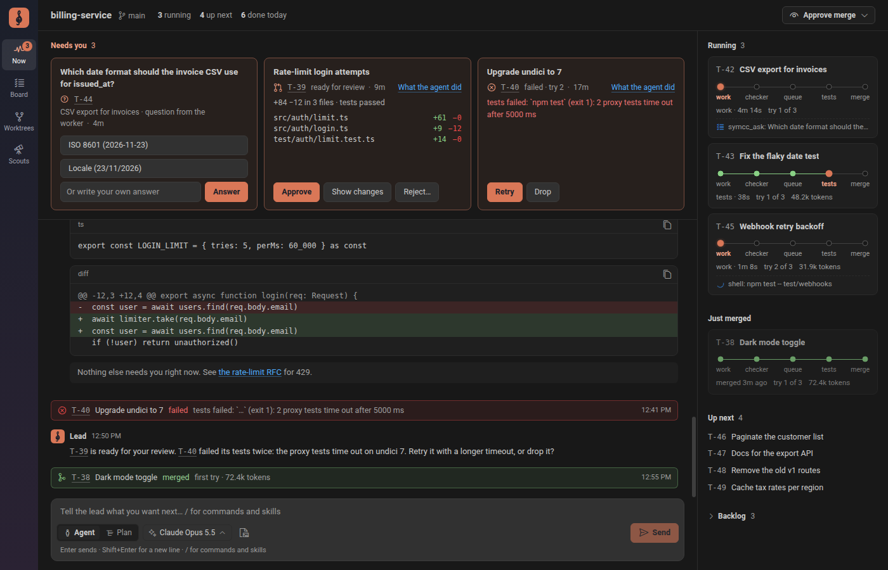
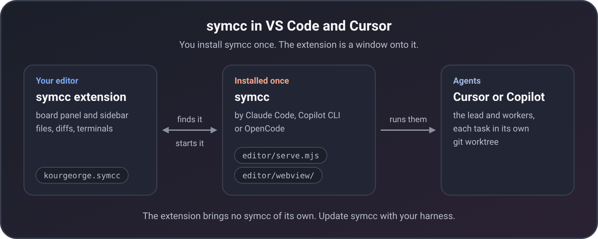
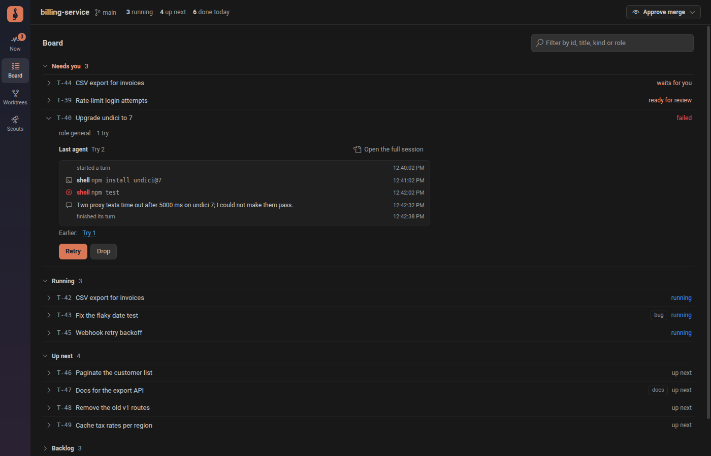
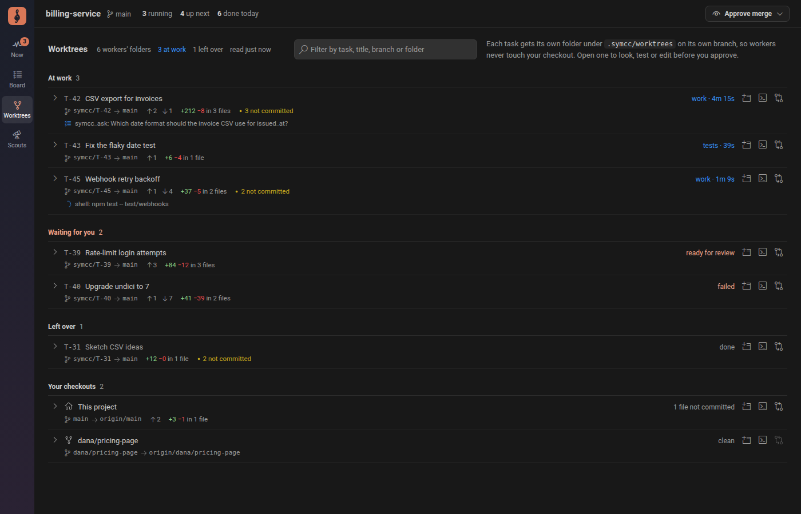

# symcc for VS Code and Cursor

Lead a team of coding agents from one chat. You talk to the lead. It plans the work as tasks on a board. Workers build
the tasks in parallel, each in its own git worktree. symcc runs your tests and merges what passes, after you approve.

This extension shows symcc's board and the lead's chat in your editor. The agents are Cursor's or GitHub Copilot's.



## What you need

- **symcc itself.** The extension runs the symcc you install with a harness. It brings no copy of its own. Install it
  once, in a terminal:

  ```bash
  claude plugin install symcc --marketplace kourgeorge/symcc
  ```

  or with GitHub Copilot CLI:

  ```bash
  copilot plugin marketplace add kourgeorge/symcc
  copilot plugin install symcc@symcc
  ```

  OpenCode installs work too, and so does a clone of
  [the repository](https://github.com/kourgeorge/symcc) (choose its folder from the symcc sidebar).
- **git**, and a project folder that is a git repository.
- **An account for the agents:**
  - Cursor's agents (the default): set `CURSOR_API_KEY` to a key from Cursor's dashboard. A login the Cursor SDK saved
    in `~/.cursor/sdk/auth.json` works too. The first run downloads the Cursor SDK from npm into a cache folder.
  - GitHub Copilot's agents: install the Copilot CLI (`npm install -g @github/copilot`), run `copilot login` once, and
    set `symcc.agents` to `copilot`, or pick Copilot in the board's model menu.
- **VS Code 1.101 or newer**, or a Cursor built on it. symcc needs Node 22.13 or newer, which these editors bring.

## How it finds symcc



The extension looks in this order:

1. The folder in the `symcc.pluginPath` setting, when you set one.
2. Claude Code's installed plugins.
3. Copilot CLI's installed plugins, and a folder you added as its marketplace.
4. OpenCode's plugin link and its plugin cache.

It runs the newest copy that speaks its version of the protocol. The status bar's tooltip says which one, for
example "symcc 0.5.42 from Claude Code". The log (**symcc: Show the log**) lists every copy it found.

When it finds none, the symcc sidebar shows how to install it. When the copy is too old or too new for the extension,
one message says what to update.

## Using it

Open the symcc icon in the activity bar, or run **symcc: Open the board**. In a new project, run **symcc: Set up symcc
in this project** (or type `/symcc-init` to the lead). Then tell the lead what you want done.

The **Board** page shows each task with its agent's steps as they happen:



The **Worktrees** page shows the folder each piece of work is in, on its branch, with its changes:



The sidebar shows the board at a glance. Its badge counts what needs you.

## Settings

| Setting | What it does |
| --- | --- |
| `symcc.agents` | Whose agents run the lead and the workers: `cursor` (default) or `copilot`. |
| `symcc.leadModel`, `symcc.workerModel` | The models to use (empty: the agents' default). |
| `symcc.pluginPath` | The symcc folder to run, instead of the newest installed one. |
| `symcc.nodePath` | A Node.js 22.13 or newer to run symcc with, instead of the editor's own. |
| `symcc.proxy` | A proxy for the agents' servers (empty: `http.proxy`, then `HTTPS_PROXY`). |
| `symcc.notify` | A notification when something new needs you while the board is out of view. |

## Updating

Update symcc where you installed it, for example
`claude plugin marketplace update symcc && claude plugin update symcc@symcc`. Then run **symcc: Restart symcc**. The
extension updates on its own, from the marketplace.

## More

- [symcc's documentation](https://github.com/kourgeorge/symcc/blob/main/docs/docs.md)
- [Issues](https://github.com/kourgeorge/symcc/issues)

The extension is MIT licensed. The Cursor SDK it downloads on first use is Cursor's, under Cursor's own terms.
